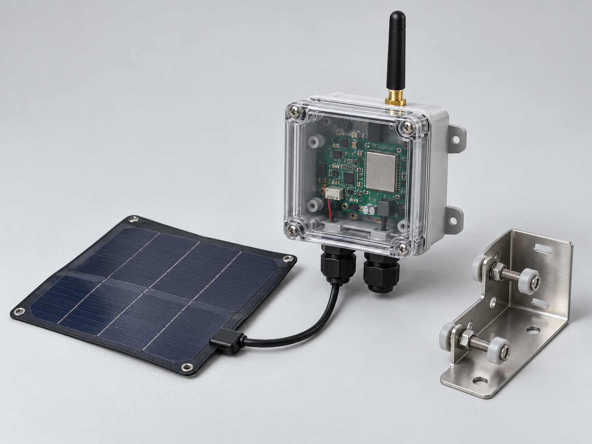
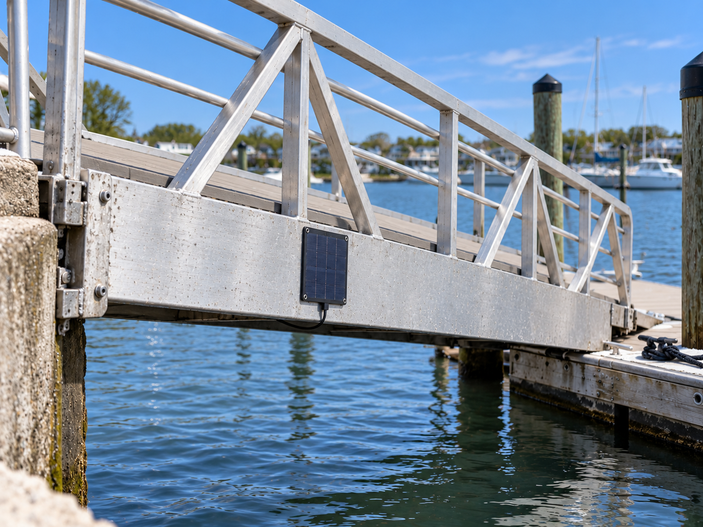
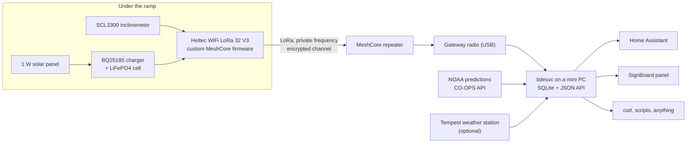

# LoRa Ramp Tide Sensor

**Measure the tide by watching a dock ramp tilt.** A small solar-powered LoRa node under a floating-dock ramp reports the ramp's angle every five minutes; a server turns that angle into real water level at a marina that has no tide gauge of its own.

> **Status: planning complete, hardware not built yet.** The design, bill of materials, battery analysis, dev plan and test plan are written and open for review. The build starts with a firmware spike and a bench rig. This is a hobby project, built in the open.



*Concept render, not a photo of a finished unit.*



*Installed (concept): only the small solar panel shows on the ramp's south-facing side face. The rest is out of sight under the ramp. AI-generated illustration, not a photo of the actual install.*

## The idea

Many marinas have a ramp (gangway) hinged at the bulkhead with its free end riding on a floating dock. As the tide moves, the ramp tilts. Over a roughly 1 m tidal range on a 25 ft ramp, that is about 6 to 7.5 degrees of swing, so 1 cm of water level is about 0.075 degrees.

```
level = h0 + L * sin(theta - theta0)
```

An inclinometer on the ramp measures `theta`. Nothing touches the water, there are no pressure ports to foul, and no dock power is needed.

The nearest NOAA station to the pilot site (8531942, Long Branch Reach) is a subordinate station that publishes only predicted highs and lows, with no observed water level. Surge and weather effects, which are the interesting part, are invisible there. This sensor is meant to fill that gap and show how far real water level departs from the predictions.

## The question this pilot answers

**Is a very small solar panel enough to keep this node alive through a New Jersey winter?**

The node is designed to use roughly 12 mAh per day. A 1 W panel on a vertical south-facing aluminum face should have a wide margin on paper, but cold-charge limits on LiFePO4 cells, shading, and real sleep current can break the paper numbers. The pilot logs panel current, battery state and charger status so that, after a winter, the data answers the question, and a half-watt panel's result can be inferred by halving the harvest.

## How it works



- **Node:** wakes every 5 minutes, samples the inclinometer for about 3 seconds, sends one small encrypted packet, and sleeps. It never listens, which keeps energy use low.
- **Transport:** [MeshCore](https://github.com/meshcore-dev/MeshCore) used as a library inside custom firmware. Stock MeshCore sensor firmware keeps the radio listening, which would cost roughly 20 times the node's energy budget.
- **Server (`tidesvc`):** decodes packets, converts tilt to level, smooths wakes and foot traffic, fits calibration against NOAA's predicted highs and lows, and serves a read-only JSON API.
- **Errors, not fiction:** if data is stale or a source is down, the API says so. It never shows predictions as observations or demo data.
- **Optional Tempest input:** barometric pressure trend and sustained onshore wind add context to surge alerts.

## Bill of materials (one node, about $150 to $210)

| Part | Pick |
|---|---|
| MCU + LoRa | Heltec WiFi LoRa 32 V3, 915 MHz |
| Tilt sensor | Murata SCL3300 breakout |
| Cell | 26650 LiFePO4 |
| Charger | TI BQ25185 (Adafruit 6091 breakout) with NTC cold cutoff |
| Panel | 1 W flexible amorphous |
| Antenna | 915 MHz 3 dBi stub |
| Enclosure | IP67 polycarbonate, clear lid |
| Mounting | stainless angle bracket, nylon isolating washers, no drilling |

Full list with links, status and open items: [docs/BOM.md](docs/BOM.md).

## Documentation

| Doc | What is in it |
|---|---|
| [PRD](docs/PRD.md) | Goals, requirements, success metrics, scope |
| [Architecture](docs/ARCHITECTURE.md) | Node firmware, gateway, server, API, energy budget, decision records |
| [Bill of materials](docs/BOM.md) | Parts, sources, open items |
| [Battery and charging](docs/BATTERY.md) | Chemistry, cell, charger, cold-weather behavior, safety, bench tests |
| [Dev plan](docs/DEV-PLAN.md) | Epics, ordered stories, issue drafts |
| [Test plan](docs/TEST-PLAN.md) | Bench, RF, server, install and solar-sufficiency protocol |

## Honest caveats

- Several battery and firmware numbers are calculated from datasheets, not measured. The docs tag each claim as verified, calculated, inferred or unverified.
- Accuracy target is plus or minus 5 cm (stretch 2 cm), not survey grade. Freeboard shifts with load, and wakes add noise.
- Do not plug USB into the node while the LiFePO4 cell is connected until the diode arrangement is bench-tested: the Heltec V3's onboard charger is a 4.2 V Li-ion charger.
- Hardware is attached to a dock ramp with the owner's permission. Check your own dock's warranty and rules before copying this.

## Prior art

A ramp-tilt tide gauge has been patented before (US11371841B2, reported lapsed for unpaid fees in 2026; status not independently verified). This project is non-commercial hobby work.

## Help wanted

The most useful contributions right now:

- **Firmware:** review of the plan for a MeshCore-library sender that sleeps between packets (spike S1 in the dev plan).
- **Low-power design:** sleep-current tricks for the Heltec V3, and a sanity check of the LiFePO4 power path.
- **Calibration:** ideas for fitting offset and effective ramp length from sparse NOAA extremes.
- **Anyone with a similar ramp:** data from other docks would be valuable.

Open an issue or start a discussion. Issues for the dev plan will be created from [docs/DEV-PLAN.md](docs/DEV-PLAN.md).

## License

Code: MIT, see [LICENSE](LICENSE). Documentation and images: CC BY 4.0, see [LICENSE-docs](LICENSE-docs).
