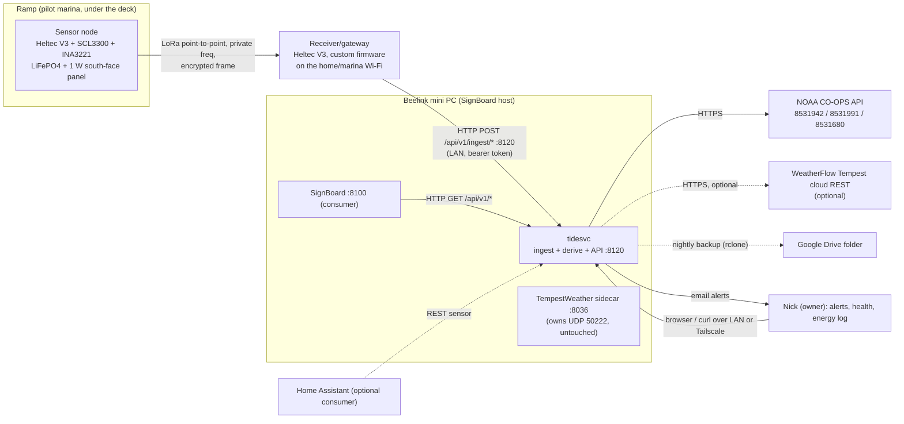
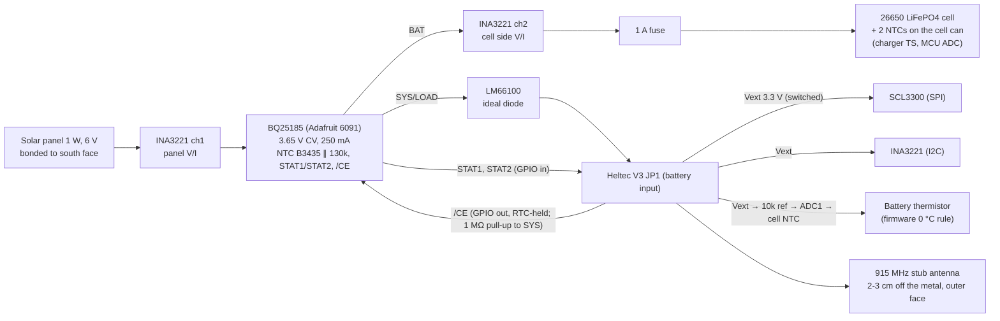
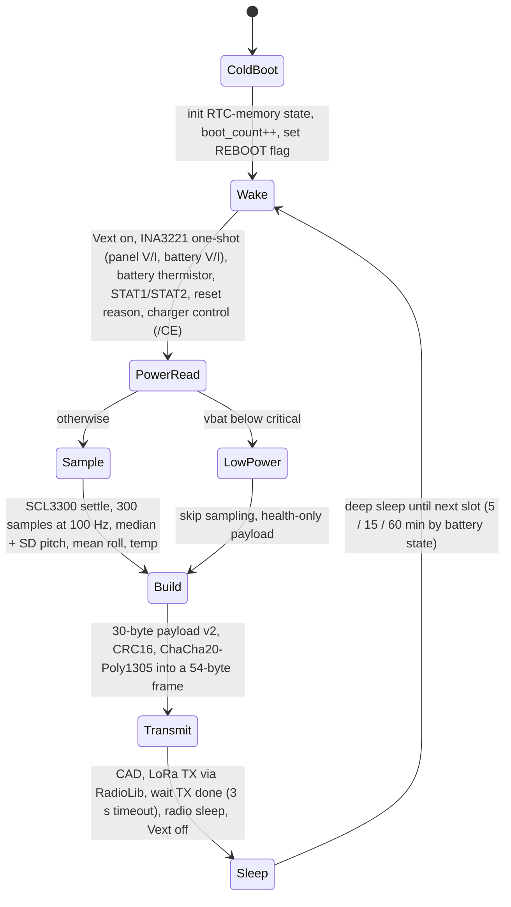
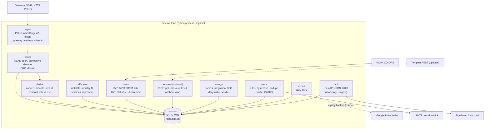
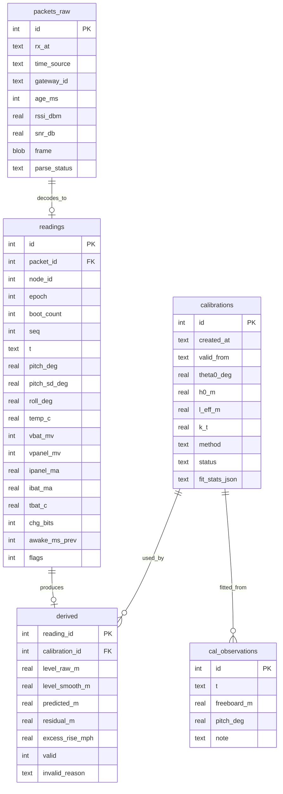

# Software Architecture: LoRa Ramp Tide Sensor

**Version:** 0.3 (draft)
**Last Updated:** 2026-11-04
**Author:** Nick DeMarco, with AI assistance (software-architecture agent)
**Status:** Draft, for Nick's review
**Inputs:** `docs/PRD.md` v0.4, `docs/BATTERY.md` v0.3 (source for the power subsystem), `workspace/research/SPEC.md` (build spec v0.1), `workspace/research/README-seed.md`

**Changes in v0.3 (2026-11-04), from Nick's decisions:**
- **Repeater removed, no mesh.** Nick's PVC-tube RAK4631 repeater is taken down. The node now sends **LoRa point-to-point** straight to a **receiver/gateway on the home/marina Wi-Fi**, which forwards each frame to `tidesvc` on the SignBoard mini PC over HTTP (port 8120). **MeshCore is dropped entirely** (library, framing and companion protocol); the radio layer is plain RadioLib with a small project frame and authenticated encryption (ADR-001, ADR-002, ADR-003 revised). This reverses the v0.2 choice of MeshCore, so it is flagged for Nick's confirmation (section 12, Q12). Sections 1, 2, 3, 4.1, 4.3, 4.4, 4.7, 5, 6, 7, 8, 9, 10, 11, 13.
- **Range without the repeater:** a single-hop link budget with every unconfirmed value marked (section 2.4). The direct link is now the main RF risk, and the gateway's position is again a real decision (it was the reason for the repeater).
- **Cell current in the payload:** payload v2 adds `ibat` (INA3221 ch2) and `tbat`; 30 bytes (section 4.7).
- **0 °C rule uses a thermistor on the battery**, read by the MCU, separate from the charger's TS thermistor (sections 4.2, 4.3; BATTERY.md 3.4).
- `NODE_SILENT` at 30 min confirmed; `REPEATER_SILENT` removed; `GATEWAY_DOWN` now means "no gateway heartbeat" (section 6.8).
- Nightly backup goes to a **Google Drive folder** (section 6.9).
- Capacity planned at **3200 mAh** (Bioenno; verify the label on arrival).
- Tempest hub radio link researched and rejected as a transport (ADR-001 alternatives).

**Changes in v0.2 (2026-10-10), from Nick's decisions:**
- Power: charger is the **TI BQ25185 on Adafruit 6091** (CN3058E-class mention removed); 26650 LiFePO4; Heltec fed from charger SYS through an **LM66100** ideal diode; B3435 NTC with 130 kΩ in parallel (hardware about -3 °C stop / +2.4 °C resume), firmware owns the 0 °C rule. Sections 1.3, 4.2, ADR-006.
- **CE polarity fixed:** on the BQ25185, /CE HIGH disables charging. A pull-up keeps charging off unless the MCU enables it; firmware pulses /CE about every 4 h for the 6 h safety timer. Sections 4.2, 4.3, 4.7.
- **Repeater:** Nick's solar PVC-tube repeater (RAK4631) is the bridge between node and gateway. Flood routing replaces zero-hop (ADR-003); the private frequency and channel must match the repeater; link-margin criteria restated per hop for the private SF/BW; repeater health added to `tidesvc` (new section 5.5, `REPEATER_SILENT`). The repeater's own power budget is outside this project's solar test. Sections 1, 2.1, 3.1, 4.7, 5, 6.8, 6.9, 7, 10, ADR-003.
- **Energy alerts:** the 14-day `ENERGY_DEFICIT` verdict is the official answer; a 7-consecutive-negative-day `ENERGY_NEGATIVE_STREAK` early-warning email is added. Sections 6.6, 6.8.
- Tempest station 183092 with SignBoard's token, surge-watch defaults, Q7 and other answers folded in (sections 6.7, 6.9, 12 and the answers log).

Nick's decisions (2026-10-10, revised 2026-11-04) that this document treats as fixed:

| # | Decision |
|---|---|
| N1 | Transport is **LoRa point-to-point** from the node to a **Wi-Fi receiver/gateway**, which forwards to the mini PC over HTTP (Nick, 2026-11-04; replaces "MeshCore"). No repeater, no mesh. |
| N2 | Data lands on the **mini PC where SignBoard runs** (the Beelink), exposed as an **HTTP JSON API**. Home Assistant, SignBoard and others are consumers only. HA is **not** in the required path. |
| N3 | Hobby project. **Owner = Nick.** No commercial intent. Permission to mount is granted (board permission per Nick, 2026-11-04). |
| N4 | The pilot's key question is **whether the 0.5-1 W vertical south-face panel is large enough**, so battery and charge telemetry and an energy log are first-class. |
| N5 | PRD defaults accepted: LiFePO4 with a low-temperature charge cutoff; accuracy targets and alert defaults from the PRD. The tilt sensor choice is delegated to architecture (ADR-005: **SCL3300**). |
| N6 | (Added mid-session) The **WeatherFlow Tempest** station is an **optional** input to the ingest service, used for context: pressure, wind and rain. |

---

## 1. Executive Summary

### 1.1 System overview

A solar-powered Heltec WiFi LoRa 32 V3 under the ramp wakes every 5 minutes. It samples a Murata SCL3300 inclinometer for 3 seconds and reads battery and solar-charge telemetry. It then sends one small **encrypted, authenticated LoRa frame** point-to-point on a private frequency and returns to deep sleep. It never listens. Push-and-sleep is what makes the node fit the energy budget of a small vertical panel (section 4.1).

A second Heltec V3, the **receiver/gateway**, sits indoors on the home/marina Wi-Fi, listens continuously on the same private settings, and **forwards each received frame unopened** (ciphertext plus RSSI/SNR) to the mini PC with an HTTP POST to port 8120. There is **no repeater and no mesh** (Nick, 2026-11-04). A single Python service, **`tidesvc`**, receives those posts, stores every frame raw in SQLite, decrypts and decodes it, converts tilt to water level, and computes the NOAA residual. It also keeps an energy log, polls the Tempest optionally, evaluates alerts, and serves a JSON API that is read-only apart from the gateway's authenticated ingest endpoints. SignBoard, Home Assistant and anything else on the LAN read that API.

### 1.2 Key architectural decisions

| Decision | Choice | Rationale | ADR |
|---|---|---|---|
| Node firmware | Custom PlatformIO firmware on **RadioLib** (no MeshCore): wake, measure, send one LoRa frame, deep sleep | With no mesh to join, MeshCore adds nothing the node needs; a push-only sender never listens. | 001 |
| Uplink message | Project frame: 8-byte clear header + 30-byte payload v2 encrypted with ChaCha20-Poly1305 (16-byte tag); 54 bytes on air | Binary, encrypted and authenticated, no handshake; the nonce comes from a persisted epoch plus seq. | 001, 004 |
| Gateway | Custom firmware on a 2nd Heltec V3: continuous LoRa RX, Wi-Fi, **HTTP POST of opaque frames** to `tidesvc` :8120, RAM queue, 60 s heartbeat | Nick's design (2026-11-04). The gateway holds no link key; decryption happens on the mini PC. | 002 |
| Radio | **Point-to-point, single hop**, private frequency and sync word, encrypted frames; settings identical on node and gateway | Nick's decisions (Q2; 2026-11-04 no repeater) | 003 |
| Tilt sensor | **SCL3300** | Purpose-built inclinometer with angle output, frame CRC and lower worst-case drift. | 005 |
| Power | 26650 LiFePO4 + **BQ25185** (Adafruit 6091) with NTC cold cutoff and firmware 0 °C rule + LM66100 feed + INA3221 energy telemetry | Answers N4 directly; details in BATTERY.md | 006 |
| Server | One Python 3.12 process (asyncio + FastAPI), SQLite (WAL), Docker Compose on the mini PC | One node and ~105k rows/year. Same deploy pattern as SignBoard. | 007, 008 |
| Errors | No demo data. Stale is an explicit error (HTTP 503 + `last_good`). | CLAUDE.md, PRD FR5 | 010 |
| Tempest | Optional REST poller with a personal token. Context and an advisory "surge watch" tier only. | UDP 50222 already has a designated listener on the mini PC. | 011 |

### 1.3 Technology stack

| Layer | Technology |
|---|---|
| Node MCU/radio | Heltec WiFi LoRa 32 V3 (ESP32-S3 + SX1262, 915 MHz) |
| Node firmware | PlatformIO, Arduino-ESP32, RadioLib (SX1262) and rweather/Crypto (ChaCha20-Poly1305), versions pinned in `platformio.ini` |
| Node sensors | Murata SCL3300 (SPI), TI INA3221 (I2C, 3-channel V/I), 10k B3435 thermistor on the cell (ADC), charger status GPIOs |
| Node power | LiFePO4 26650 (**3200 mAh planning value**, Bioenno; verify the label), TI BQ25185 on Adafruit 6091 (3.65 V, 250 mA) with 10k B3435 NTC ∥ 130 kΩ, LM66100 ideal diode to Heltec JP1, 1 W 6 V flexible amorphous panel (BATTERY.md) |
| Gateway | Heltec V3 (ESP32-S3 + SX1262) with custom receive-and-forward firmware (RadioLib, Wi-Fi STA, HTTP client), USB 5 V wall power, on the home/marina Wi-Fi |
| Service | Python 3.12, FastAPI + uvicorn, httpx, numpy, `cryptography` (ChaCha20-Poly1305), stdlib `sqlite3` |
| Storage | SQLite 3 (WAL) on a Docker volume, daily CSV exports, nightly backup to a Google Drive folder |
| Deploy | Docker Compose on the Beelink mini PC (separate project from SignBoard), reached over the LAN and Tailscale |
| External data | NOAA CO-OPS datagetter (8531942, 8531991 predictions; 8531680 observed), WeatherFlow Tempest REST (optional) |

---

## 2. Radio link: LoRa point-to-point (v0.3)

### 2.1 What remains of MeshCore: nothing

**Decision (architecture, 2026-11-04; Nick to confirm, Q12): MeshCore is dropped entirely.** The node and the gateway use plain LoRa through **RadioLib** (the SX1262 driver MeshCore itself sat on), a small project frame (2.2), and authenticated encryption from rweather/Crypto (the crypto library MeshCore also used). No MeshCore library, packet framing, channel hashing, companion firmware or `meshcore_py`.

Why:
- MeshCore's value is routing, repeaters, adverts and interoperability with other mesh radios. With one node, one receiver and no repeater (Nick, 2026-11-04), none of that is used.
- The stock companion firmware cannot post HTTP, so the gateway is custom firmware either way. Building that gateway on MeshCore would put the channel secret on a Wi-Fi device and keep MeshCore's 2-byte MAC.
- It removes the architecture's riskiest unverified premise (spike S1 v0.2: a MeshCore `Mesh` subclass with no identity that sends and deep-sleeps) and the dependency on MeshCore's moving internals.
- Cost: we own a ~60-line frame format and its golden vectors, and lose "no custom gateway firmware" (ADR-002 v0.2).

**The fork, stated plainly:** Nick chose MeshCore over raw LoRa on 2026-10-10 (PRD D8). His 2026-11-04 design (direct point-to-point to a Wi-Fi gateway) removes the reasons for it, but the switch to plain RadioLib is this document's call. The alternative is to keep MeshCore `GRP_DATA` framing on the node and write a MeshCore-library gateway that decrypts and posts. That is viable but heavier for no gain here. Recorded as Q12.

### 2.2 Frame format (ADR-004)

| Part | Bytes | Content |
|---|---|---|
| Header (clear, authenticated as AAD) | 8 | `fmt` u8 = `0x54` ("T", frame format 1); `node_id` u8; `epoch` u32; `seq` u16 (little-endian) |
| Ciphertext | 30 | Payload v2 (section 4.7), ChaCha20-Poly1305 |
| Tag | 16 | Poly1305 tag over header + ciphertext |
| **Total** | **54** | LoRa explicit header and LoRa CRC on |

- **Key:** 32-byte link key, provisioned into node NVS over USB and held by `tidesvc` in `.env` (`TIDE_LINK_KEY`). **The gateway never has it.** It forwards ciphertext, which keeps the key off a device on a shared Wi-Fi network.
- **Nonce (12 bytes):** `node_id ‖ epoch ‖ seq ‖ 0x00×5`. `epoch` is persisted in NVS and incremented on every cold boot (before the first TX) and whenever `seq` wraps, so a (key, nonce) pair never repeats. An NVS write happens only on a cold boot or a wrap (about every 227 days), never per cycle.
- **De-duplication and replay:** `tidesvc` de-duplicates on `(node_id, epoch, seq)` and rejects frames from an epoch older than the newest seen. The payload's own `node_id` and `seq` must equal the header's; a mismatch is a codec error.
- **Radio settings:** a private frequency inside 902-928 MHz, the RadioLib private sync word (`0x12`, not LoRaWAN's `0x34`), explicit header, CRC on, 8-symbol preamble. Frequency, SF, BW and CR are chosen in DEV-PLAN E4.2 and must match on node and gateway.
- **Listen-before-talk:** one RadioLib channel-activity scan before TX. If busy, back off a random 0.2-1 s once, then send.

### 2.3 Size and airtime

Airtime for the 54-byte frame (Semtech time-on-air formula, BW125, CR 4/5, 8-symbol preamble, explicit header, CRC on; low-data-rate optimisation from SF11). TX charge at 145 mA (22 dBm, **assumed**, section 4.4):

| Setting | Airtime | TX charge per frame | TX mAh/day at 288 frames |
|---|---|---|---|
| SF7 / BW125 | 103 ms | 15 mAs | 1.2 |
| SF8 / BW125 | 185 ms | 27 mAs | 2.1 |
| **SF9 / BW125 (planning start)** | **349 ms** | **51 mAs** | **4.0** |
| SF10 / BW125 | 616 ms | 89 mAs | 7.2 |
| SF11 / BW125 | 1315 ms | 191 mAs | 15.3 |
| SF12 / BW125 | 2466 ms | 358 mAs | 28.6 (exceeds the whole budget) |

For comparison, v0.2's 37-byte MeshCore frame took 181 ms at SF7/BW62.5. SF11 and SF12 are not usable inside the 25 mAh/day budget (section 4.4). Frames longer than 400 ms (SF10 and up) also matter if the FCC Part 15 basis for a single fixed channel turns out to involve a dwell-time limit; that basis is **[unverified]** (section 13).

### 2.4 Link budget without the repeater (single hop)

The repeater existed because nobody knew whether a radio at the mini PC could hear the ramp (v0.2 Q1). Dropping it puts that question back on the table. The receiver now sits on the home/marina Wi-Fi rather than at the mini PC, so it can be placed wherever Wi-Fi reaches. But **the ramp-to-gateway distance, the gateway's height and the window type are not known**. Every number below is a planning assumption until the link test (TEST-PLAN RF-3/RF-4).

| Term | Value | Status |
|---|---|---|
| TX power | +22 dBm | SX1262 maximum (datasheet). Heltec V3 delivered power **[unverified]** |
| Node antenna | 3 dBi nominal (Doodle ANT-915-3-O), 2-3 cm off aluminium under the ramp | Effective gain near the metal **[unknown]**. Shadowing below is an assumption |
| Gateway antenna | 3 dBi | **[assumed]** indoor stub, or an outside omni on short coax |
| Cable and connector loss | 1 dB each end | **[assumed]** |
| RX sensitivity, BW125 | about -124 / -129 / -132 dBm at SF7 / SF9 / SF10 | SX1262 typical figures, **[unverified for the Heltec V3]** |
| **Maximum path loss** | **about 150 / 155 / 158 dB** at SF7 / SF9 / SF10 | **[C]** 22 + 3 + 3 − 2 − sensitivity |
| Required margin | 10 dB | Unchanged acceptance rule (section 5.4) |
| **Allowed path loss with margin** | **about 140 / 145 / 148 dB** | **[C]** |

Expected losses, all **[assumed]**:
- **Low antenna over water.** The node antenna sits about 0.5 m above the water. Beyond about 100 m (two-ray crossover with a 5 m-high gateway), loss follows the two-ray model: `PL ≈ 40·log10(d) − 20·log10(h_node) − 20·log10(h_gw)`. That gives about **91 dB at 300 m, 100 dB at 500 m and 112 dB at 1 km** (h_node 0.5 m, h_gw 5 m). Free space alone would be 86 dB at 500 m.
- **Ramp and bulkhead shadowing:** 10-20 dB. The antenna is under an aluminium ramp beside a bulkhead.
- **Building entry:** 2-5 dB through plain glass. **Coated (low-E) glass or a wall can add 20 dB or more [I].**
- Boats, pilings and people: variable. Covered by the margin and the 48 h test across tides.

Worked cases: 500 m to a plain-glass window 5 m up is about 100 + 20 + 5 = **125 dB**, which leaves about 30 dB over the 10 dB margin at SF9. 1 km behind low-E glass is about 112 + 20 + 25 = **157 dB**, which **fails even at SF10**.

**Conclusion.** A direct link is plausible at a few hundred metres with a sensible gateway window. It is not assured, and the outcome depends on facts nobody has measured. **If margin is short**, try these in order: (1) raise the SF on both radios (SF10 at most, energy permitting); (2) move the gateway antenna outside or higher on short coax; (3) move the gateway to a closer spot that still has Wi-Fi; (4) set `tx_repeats = 1`. Reinstating a relay would be a new decision for Nick (DEV-PLAN 7).

### 2.5 What could not be verified

- **[unverified]** RadioLib + rweather/Crypto on the Heltec V3: wake, CAD, TX of 54 bytes, then deep sleep, with no RX. Spike **S1** (revised).
- **[unverified]** Byte-for-byte interoperability of rweather/Crypto `ChaChaPoly` and Python `cryptography` `ChaCha20Poly1305`, with the header as AAD. Both claim RFC 8439. Golden vectors decide (E3.4).
- **[unverified]** The FCC Part 15 basis for a single fixed 915 MHz channel at +22 dBm. PRD v0.3 assumed "license-free at the chosen power" for MeshCore. The same assumption carries over and still needs checking.
- **[unverified]** Real RX sensitivity, delivered TX power and the node antenna's pattern next to aluminium.

### 2.6 MeshCore notes (v0.2, superseded)

Kept for the record, from research verified 2026-10-10. MeshCore companion v1.17.1 forwarded channel datagrams (`GRP_DATA`) to a host as frame `0x1B` through `meshcore_py` 2.3.15. The USB companion queued 16 frames. Group datagrams carried no sender timestamp. The cipher was AES-128 with a 2-byte MAC. The stock `simple_sensor` listens continuously, about 20x the node's energy budget. None of this is used from v0.3.

---

## 3. System Context

### 3.1 Context diagram



### 3.2 External systems

| System | Purpose | Integration | Required? |
|---|---|---|---|
| NOAA CO-OPS datagetter | Predicted hi/lo for **8531942 Long Branch (inside)**, the prediction baseline. Predicted hi/lo for 8531991 (ocean phase reference). **Observed** level and 6-min predictions at **8531680 Sandy Hook** (weather-residual cross-check, calibration gating). | REST, JSON, no key (`application=lora_ramp_tide_sensor`) | Level works without it; **residual needs it** |
| WeatherFlow Tempest | Pressure, wind, rain context | REST + personal access token | **Optional** |
| Google Drive | Off-box copy of the nightly SQLite backup | `rclone` to a folder Nick designates | Backup only |
| SignBoard | Tide panel on kiosks | It polls our API | Consumer |
| Home Assistant | Whoever runs one | REST sensor | Consumer, optional |
| SMTP | Alert email to Nick | SMTP submission | Alerts only |

Verified 2026-10-10 against the live API:
- 8531942 returns `interval=hilo` only. `interval=6` returns "No Predictions data was found".
- **8531991 (Long Branch Fishing Pier) has no observed water level.** It is prediction-only too. **Sandy Hook 8531680 is the only nearby observed gauge.** This corrects SPEC §6, which treats 8531991 as an "ocean gauge" for weather residuals. It can still be used as an ocean-phase prediction reference.

### 3.3 Actors

| Actor | Interaction |
|---|---|
| Nick (owner/operator) | Install and calibration CLI, health and energy views, alert email, deploys |
| Residents / boaters | SignBoard tide panel (via SignBoard, not this service directly) |
| Consumers (SignBoard, HA, scripts) | Read-only JSON API on the LAN |
| Gateway | Posts frames and heartbeats to the token-protected ingest endpoints |

---

## 4. Node: Hardware and Firmware Design

### 4.1 Why custom push-and-sleep firmware

| Option | Energy | Sensor support | Verdict |
|---|---|---|---|
| Stock MeshCore `simple_sensor` (v0.2 research) | Radio in RX continuously: even **10 mA is 240 mAh/day, ~20x our push budget** | No SCL3300 driver; 60 s reads, not a 3 s/100 Hz burst | Rejected (and MeshCore dropped, section 2.1) |
| **Custom firmware on RadioLib, push + deep sleep** | ~10-14.5 mAh/day at SF7-SF9 (section 4.4) | Our own SCL3300, INA3221 and battery-thermistor drivers | **Chosen** (ADR-001) |

The node **never receives**. It does a channel-activity scan before TX (section 2.2), sends one frame and sleeps. Consequence: **no downlink.** Configuration changes need USB (section 4.7).

### 4.2 Hardware block diagram



Notes and bench items:

The power subsystem is specified in `docs/BATTERY.md` (wiring in its section 3.4); this section only summarises it.

- **Do not connect USB to the Heltec V3 while the LiFePO4 cell is attached, until bench test T6 (BATTERY.md) passes.** The board's onboard charger is a Li-ion (4.2 V) charger and would overcharge LiFePO4 (3.65 V max). The LM66100 ideal diode between charger SYS and Heltec JP1 should block it, but that is unverified. Label the enclosure. Use a battery disconnect or a jumper for programming. **[bench-verify]**
- The Heltec is fed from the BQ25185 **SYS/LOAD** output through the **LM66100** into **JP1** (1.25 mm battery connector), never into the 3V3 or 5V pins. SYS is panel-powered in sun and cut off below BUVLO 3.0 V. On battery, the onboard LDO may leave the 3.3 V rail near or slightly below the ESP32-S3's 3.0 V minimum during TX. Measure the brownout point on the bench (sweep 3.6 → 2.9 V, BATTERY.md T4). **[bench-verify]**
- **Cold charging (Nick, 2026-10-10).** The cell must not charge below 0 °C. Two layers:
  - Hardware backstop: the BQ25185 TS input with a **10k B3435 NTC bonded to the cell and 130 kΩ in parallel**, which moves the charger's window to about **-3 °C stop / +2.4 °C resume** (calculated, BATTERY.md 4.3-4.4; measure with T2).
  - Firmware owns the 0 °C rule: it **disables** charging below +1 °C and re-enables above +2 °C, using a **thermistor on the battery** (Nick, 2026-11-04). This is a second 10k B3435 NTC bonded to the cell can next to the charger's, read by an ESP32-S3 ADC1 pin through a 10 kΩ 0.1% reference resistor from the switched Vext rail. It is powered only while awake and is separate from the TS circuit, so the two layers stay independent. An open or shorted thermistor (ADC near either rail) counts as "temperature unknown" and disables charging. The SCL3300 die temperature is no longer the battery proxy; it stays in the payload for tilt temperature compensation (`k_T`). Expected accuracy is about ±0.5 °C near 0 °C with 1% NTC tolerance and a calibrated ADC **[C/I; bench B9 measures it]**.
- **/CE polarity (BQ25185):** /CE **HIGH disables charging**, LOW enables. A **1 MΩ pull-up from /CE to SYS** keeps charging **off unless the MCU actively drives /CE LOW**; the GPIO state is held through deep sleep (`gpio_hold_en`). If the MCU is dead, charging stays off; in sun SYS still powers the MCU so it can boot and re-enable (bench-verify, BATTERY.md T3). The firmware reports `cold_charge_inhibit` whether the inhibit comes from the charger (STAT fault) or from its own rule (CE override bit).
- **Charger status** comes from STAT1/STAT2 (open drain, pull-ups to 3V3): 1/0 charging; 1/1 done or disabled; 0/1 recoverable fault (TS cold or hot, OVP, thermal); 0/0 latch-off fault (safety timer, BATOCP). Firmware maps these to the `chg` byte (section 4.7), using its own temperature reading to tell a cold fault from the other 0/1 causes.
- **Vbat and cell current** are read by the INA3221 on the cell side (ch2: bus voltage and shunt current, sent as `vbat` and `ibat`). The Heltec's own battery ADC now sees SYS, not the cell.
- The SCL3300, INA3221 and battery-thermistor divider sit on the switched Vext rail, so they draw nothing during sleep. The INA3221 is also put in power-down mode between reads.

### 4.3 Duty cycle



| Battery state (LiFePO4, under light load) | Interval | Payload |
|---|---|---|
| Normal (≥ 3.15 V) | 5 min | Full |
| Low (3.05-3.15 V) | 15 min, `reduced_interval` flag | Full |
| Critical (< 3.05 V) | 60 min | Health only (`sensor_skipped`) |

These thresholds are placeholders until the bench brownout measurement. LiFePO4's flat curve makes voltage a poor state-of-charge gauge above the knee. That is why the server also counts charge (section 6.6).

**Charger control (every wake, BQ25185 /CE: HIGH = charging disabled).**
- **0 °C rule:** if the **battery-thermistor** temperature is below +1 °C, or unknown (thermistor open/short, `tbat_error`), drive /CE HIGH (disable) and set the CE-override bit. Above +2 °C, drive /CE LOW (enable). Between +1 and +2 °C, keep the previous state (hysteresis). The pull-up makes "disabled" the default if the MCU is not driving the pin.
- **Safety-timer pulse:** the BQ25185 latches charging off after 6 h of fast charge, and termination may never happen while a weak panel holds it in VINDPM. Firmware counts continuous "charging" time (STAT 1/0) in RTC memory and, after about **4 h**, pulses /CE HIGH briefly (then LOW again) to restart the timer. Nightly loss of panel input also clears it. Bench test: BATTERY.md T7.
- Both are pure functions of (temperature, STAT, elapsed charging time) so they can be unit-tested natively.

**Cadence accuracy:** the Heltec V3 has no 32 kHz crystal populated **[unverified]**, so deep-sleep timing runs on the ESP32-S3's internal RC oscillator and can drift by about 1-5%. The server timestamps on arrival and the cadence is not used in any calculation. This architecture therefore relaxes **PRD FR1 "every 5 min ±10 s" to "5 min ±5%"** (accepted by Nick, Q8; PRD v0.3).

**Ack and retry:** SPEC §4 suggests an ack plus one retry. Receiving an ack would mean listening, so there is none (D16). Loss is measured with sequence numbers instead. A `tx_repeats` option (default 0) can send the same frame twice about 1.5 s apart if the range test shows marginal delivery. The server de-duplicates on `(node_id, epoch, seq)`.

### 4.4 Energy budget (load)

Estimated per-cycle profile. **Every number is an estimate until it is measured on the bench** (PPK2/Otii or a µCurrent).

| Phase | Duration | Current | Charge |
|---|---|---|---|
| Wake from deep sleep + init (no SPIFFS, no keys) | 0.30 s | 40 mA | 12 mAs |
| Vext on, INA3221 + charger pins | 0.10 s | 25 mA | 2.5 mAs |
| SCL3300 start-up/settle **[datasheet timing unverified]** | 0.25 s | 25 mA | 6 mAs |
| Sampling 300 @ 100 Hz | 3.0 s | 25 mA | 75 mAs |
| Radio init + channel-activity scan; battery-thermistor read (negligible) | 0.10 s | 30 mA | 3 mAs |
| TX 54 B at 22 dBm, **SF9/BW125 (~349 ms; planning start)** | 0.35 s | 145 mA | 51 mAs |
| **Per cycle (SF9)** | **~4.1 s** | | **~150 mAs ≈ 0.042 mAh** |

| Item | mAh/day |
|---|---|
| 288 cycles at SF9 (at SF7: 113 mAs/cycle, 9.1 mAh/day) | 12.0 |
| Deep sleep, 30-100 µA (board + charger leakage + INA power-down) **[Heltec V3 real sleep current unverified; SPEC says ~20 µA, which is optimistic once a battery divider and charger are attached]** | 0.7-2.4 |
| **Nominal total** | **~12.5-14.5 at SF9; ~10-11.5 at SF7** |
| **Design budget (2x contingency at SF7-SF9)** | **25 mAh/day ≈ 80 mWh/day at 3.2 V** |

v0.2 estimated ~125 mAs/cycle and ~11-12.5 mAh/day for a 37-byte MeshCore frame at SF7/BW62.5. The v0.3 frame is longer (54 B, with the 16-byte tag), and the planning start moves to SF9 because there is no repeater. SF10 gives ~188 mAs/cycle and ~16-17.5 mAh/day, still inside the budget. SF11 (~289 mAs) uses up the budget and is out. TX at 14 dBm instead of 22 dBm saves about 25 mAs per cycle at SF9. Pick SF and power from the range test (section 5.4).

**Battery autonomy** (80% usable, at the 25 mAh/day budget): a 26650 LiFePO4 at the **3200 mAh** planning value (Bioenno; Nick, 2026-11-04; verify the cell label on arrival) gives **~102 days**. An 18650 LiFePO4 (~1500 mAh) gives **~48 days**. Both easily exceed the PRD's 14-day no-sun target. **26650 chosen** (Q7: fits the Fibox PCB 65T by outside dimensions; physical fit still to be verified). BATTERY.md 2.1 gives about 51 days with cold and aging derating.

### 4.5 Winter solar estimate: vertical south face, Monmouth Beach NJ

Source: **PVGIS v5.3** (EU JRC) monthly irradiation on a 90°, south-facing plane at 40.333 N, 73.981 W, ERA5 reanalysis, 2005-2023, DEM terrain horizon only. NREL PVWatts was unreachable from the research sandbox. Daily averages in kWh/m²/day, which equal peak-sun-hours (PSH):

| Month | Horizontal | **Vertical south (mean)** | Vertical south (worst year) |
|---|---|---|---|
| Nov | 2.31 | 3.94 | 2.89 |
| **Dec** | 1.75 | **3.45** | **2.75** |
| Jan | 2.12 | 3.88 | 2.98 |
| Feb | 2.98 | 4.14 | 2.92 |
| Jun (for contrast) | 6.31 | 2.33 | 2.11 |

A vertical south face collects **more** in winter than in summer at this latitude, which supports Nick's choice of mounting.

Harvest = panel W × PSH × η. Take η ≈ 0.5: a linear LiFePO4 charger delivers about Vbat/Vmp ≈ 0.6 of panel power, times ~0.85 for temperature, soiling, wiring and mismatch. Compared with the **80 mWh/day design budget**:

| Case | PSH | 0.5 W panel | 1 W panel |
|---|---|---|---|
| Dec mean | 3.45 | 0.86 Wh (10.8x) | 1.73 Wh (21.6x) |
| Dec worst year | 2.75 | 0.69 Wh (8.6x) | 1.38 Wh (17.2x) |
| Dec worst year, **50% local shading** (piles, boats, structure; unknown) | 1.38 | 0.34 Wh (4.3x) | 0.69 Wh (8.6x) |
| Single heavy-overcast day (vertical POA ≈ 0.4 kWh/m², **assumed**) | 0.4 | 0.10 Wh (1.25x) | 0.20 Wh (2.5x) |

**Conclusion.** On paper, panel size is not the binding constraint. 0.5 W is adequate and 1 W is comfortable, even with heavy shading. Three things can actually break winter operation, and the energy log is built to measure each one:

1. **Cold-charge inhibition.** A LiFePO4 cell under a shaded ramp will not charge on days when it stays below 0 °C. On those days harvest is zero regardless of panel size. Logged as `charge_inhibit_cold_h` per day.
2. **Local shading**, from the float, piles, boats in the adjacent slip, and the low December sun (~26° at noon). Logged as daily harvest against a clear-sky expectation.
3. **Real sleep current** of the Heltec V3 in this power path. Measured on the bench and checked in the field against battery drift on cold days.

PVGIS ERA5 caveats: it is reanalysis and can overstate irradiance under persistent cloud, and it includes no near-field obstructions. Treat the table as an upper-bound envelope, not a guarantee.

### 4.6 Measurement details

- **SCL3300**: SPI. Use the inclination-oriented low-noise mode with ~10 Hz on-chip filtering **[exact mode numbers and settling time from the datasheet are unverified]**. The 100 Hz reads are therefore correlated, giving about 30 effective samples per burst. That is still far inside the 0.01° target given ~0.001°/√Hz noise density.
- Per-cycle values: **median pitch**, **pitch SD**, **mean roll** (detects bracket creep or ramp twist), and **sensor temperature** (used for tilt temperature compensation; battery temperature now comes from the cell thermistor, section 4.2).
- Any frame with a bad SPI CRC or status → `sensor_error`, and the pitch fields are invalid.
- Coarse on-node out-of-range check: |pitch| > 15° or |roll| > 10° sets `out_of_range`. The fine envelope check runs on the server against the calibrated range, because the node cannot be reconfigured over the air.

### 4.7 Uplink payload v2 (ADR-004)

Little-endian. The payload is the plaintext inside the frame of section 2.2. v2 is v1 with two fields appended before the CRC: **`ibat` (cell current, Nick 2026-11-04)** and `tbat` (the battery-thermistor reading the 0 °C rule acted on). `ver` becomes 2.

| Off | Field | Type | Unit / notes |
|---|---|---|---|
| 0 | `ver` | u8 | `2` |
| 1 | `node_id` | u8 | `1` for the pilot; must equal the frame header's |
| 2 | `seq` | u16 | increments per frame; wraps in ~227 days at 5 min (a wrap also bumps `epoch`, section 2.2); must equal the header's |
| 4 | `boot_count` | u8 | wraps; reboot indicator (de-dup uses the header's `epoch`) |
| 5 | `pitch_med` | i16 | 0.001° (±32.767°) |
| 7 | `pitch_sd` | u16 | 0.001°. Was u8 in the SPEC; widened so wake and storm SD does not saturate at 0.255°. |
| 9 | `roll_mean` | i16 | 0.01° |
| 11 | `temp` | i16 | 0.1 °C (SCL3300 die; tilt compensation) |
| 13 | `vbat` | u16 | mV (INA3221 ch2 bus) |
| 15 | `vpanel` | u16 | mV (INA3221 ch1 bus) |
| 17 | `ipanel` | u16 | 0.1 mA, panel-side charger input current |
| 19 | `chg` | u8 | bit0 CHRG (STAT 1/0), bit1 DONE (STAT 1/1 while /CE is LOW), bit2 cold_charge_inhibit (STAT 0/1 with low temperature, or firmware cold rule), bit3 firmware CE override (/CE held HIGH by firmware), bit4 charger latch fault (STAT 0/0), bit5 safety-timer CE pulse issued this cycle |
| 20 | `awake_ms_prev` | u16 | awake time of the previous cycle (energy accounting) |
| 22 | `flags` | u16 | bit0 low_batt, 1 critical_batt, 2 high_sd, 3 out_of_range, 4 reboot, 5 brownout_reset, 6 wdt_reset, 7 sensor_error, 8 ina_error, 9 reduced_interval, 10 sensor_skipped, 11 short_sample, **12 tbat_error** |
| 24 | **`ibat`** | **i16** | **0.1 mA, INA3221 ch2 shunt; positive = into the cell (charging), negative = discharge** (±3276.7 mA) |
| 26 | **`tbat`** | **i16** | **0.1 °C, battery thermistor; `0x8000` if `tbat_error`** |
| 28 | `crc16` | u16 | CRC-16/CCITT-FALSE over bytes 0-27 |

Total: **30 bytes**. The CRC is kept even though the AEAD tag authenticates the frame, because it catches codec mismatches between the C++ and Python implementations, which the tag cannot.

**What `ibat` measures:** a snapshot taken while the node is awake. At night it reads the awake draw (about −25 mA), not the sleep current. In sun it reads charge current minus the awake load. The server corrects it like `ipanel`: add back the modelled awake-vs-average load difference (BUILD deviation 2). That gives a **direct net-charge series** to check against harvest − consumption (section 6.6). This closes DEV-PLAN 7 item 8 (v0.2).

**Provisioning:** the 32-byte link key, node id, TX power, the private radio settings (frequency, SF, BW, CR, sync word; identical to the gateway) and `tx_repeats` are written to NVS over USB serial with a one-time `provision` command. The firmware creates `epoch` itself. The key is **not** compiled into the firmware or committed to git. The same key goes into `tidesvc`'s `.env` as `TIDE_LINK_KEY`, and **not** into the gateway.

### 4.8 Firmware repository layout

```
firmware/                 (BUILD.md; ARCHITECTURE v0.2 said src/node-firmware/)
  platformio.ini          # envs heltec_v3_tide (node), heltec_v3_gateway (receiver), native
  lib/tidecore/           # portable: payload codec, frame + AEAD, stats, battery state machine, cold rule, CE pulse
  src/main.cpp            # node cycle state machine
  src/gateway/            # gateway RX, queue, Wi-Fi, HTTP POST, heartbeat
  include/hal_heltec_v3.h # pins: SPI, I2C, STAT, /CE, thermistor ADC, Vext
  test/                   # native tests on the shared vectors (tests/vectors/)
```

---

## 5. Gateway: Wi-Fi Receiver and Forwarder

### 5.1 Hardware and placement

- **Hardware:** a second Heltec V3 (about $20-30), powered by a USB 5 V wall adapter. No battery, so the LiFePO4 USB hazard does not apply. It uses a 915 MHz antenna: an indoor stub at a window facing the ramp, or an outside omni on a short coax run.
- **Placement:** anywhere on the **home/marina Wi-Fi** with the best view of the ramp. It does not have to sit next to the mini PC, which is why the direct link has a chance (section 2.4). The site visit records the candidate spot, its distance to the ramp, height and glazing (E0.1).
- **Network:** the gateway must reach the mini PC's port 8120 over the LAN. If the Wi-Fi it joins cannot reach the mini PC, a route is needed (DEV-PLAN 7). No address is hard-coded in git; the server URL is provisioned into NVS.

### 5.2 Gateway firmware (custom, in this repo)

PlatformIO env `heltec_v3_gateway`, sharing the radio settings and frame constants with the node:
- **Continuous RX** on the private settings (RadioLib interrupt). For each frame it checks the LoRa CRC, length 54 and `fmt = 0x54`, then enqueues `{payload bytes, rssi_dbm, snr_db, freq_err_hz, rx_millis}`. It does not decrypt.
- **Queue:** a RAM ring of 288 frames (24 h at 5 min). If a POST fails, frames stay queued and are retried with backoff (5 s → 5 min). The queue is lost if the gateway loses power.
- **Forwarding:** `POST /api/v1/ingest/frames` with a JSON batch (5.3) and a bearer token. Each frame carries `age_ms` (time since reception, from the gateway's monotonic clock), so `tidesvc` can date queued frames without NTP or seq back-dating.
- **Heartbeat:** `POST /api/v1/ingest/heartbeat` every 60 s, with uptime, firmware version, Wi-Fi RSSI, queue depth, frames received, LoRa CRC errors and wrong-format frames since boot, and the noise floor measured between frames.
- **Robustness:** a task watchdog, Wi-Fi reconnect with backoff, and a reboot if no POST has succeeded for 30 min while Wi-Fi is up.
- **Provisioning:** over USB serial into NVS: Wi-Fi SSID and password, server URL, ingest token, gateway id (`tide-gw`) and radio settings. **None of these are in git.** There is no remote configuration surface.
- The OLED may show the last frame's time and RSSI. That is optional and off by default.

### 5.3 Ingest protocol

```mermaid
sequenceDiagram
    participant N as Node
    participant G as Gateway (Wi-Fi)
    participant I as tidesvc.ingest (HTTP)
    participant D as SQLite
    participant X as tidesvc.derive
    N->>G: LoRa frame (54 B, encrypted), point-to-point
    G->>G: LoRa CRC, fmt, length; enqueue with RSSI/SNR
    G->>I: POST /api/v1/ingest/frames (bearer token)
    I->>D: INSERT packets_raw (always, even if it fails to decrypt)
    I->>I: AEAD open with TIDE_LINK_KEY, CRC, decode v2, de-dup
    I->>D: INSERT readings
    I-->>G: 200 {accepted: n}
    I->>X: notify(reading_id)
    X->>D: INSERT/UPDATE derived (level, smoothed, predicted, residual)
```

Request body (`application/json`):
```json
{
  "gateway_id": "tide-gw",
  "fw": "gw-0.1.0",
  "frames": [
    {"age_ms": 1840, "rssi_dbm": -108.0, "snr_db": 4.25, "freq_err_hz": -312, "payload_hex": "54010700000012..."}
  ]
}
```

- `200` with `{"accepted": n, "duplicates": k}` once every frame is stored raw. The gateway deletes them from its queue only after a 200. A retried batch is safe because duplicates are recognised.
- `401` for a missing or wrong token: nothing is stored. `400` for malformed JSON. `503` if the database writer is unavailable: the gateway keeps the batch.
- **Authenticity comes from the frame tag, not the token.** A frame that fails to decrypt is stored raw with `parse_status = bad_tag` and never becomes a reading. The token only keeps junk out of the raw table and protects the heartbeat.

### 5.4 Radio settings and acceptance (ADR-003)

- **Private frequency, private sync word, encrypted frames** (Q2, carried over). One frequency/SF/BW/CR inside 902-928 MHz, chosen from a local noise survey (DEV-PLAN E4.2), is set **identically on the node and the gateway**. The planning start is **SF9/BW125**, because there is no repeater (section 2.4). SF7-SF8 are fine if the link test shows the margin, and SF10 is the upper limit.
- **Single hop.** No routing, no flood, no relayed duplicates. Duplicates now come only from gateway retries or `tx_repeats`.
- **Accept the link if**, over a 48 h test from the final node position (stub antenna, under the ramp) to the gateway in its final position: **delivery ≥ 95%**, and **≥ 10 dB margin over the demodulation floor of the chosen SF** (approximately −7.5 / −10 / −12.5 / −15 dB for SF7-SF10). So the median SNR must be at least +2.5 dB at SF7, 0 dB at SF8, −2.5 dB at SF9, −5 dB at SF10. The gateway reports SNR and RSSI for every frame, so the single hop is measured directly. The 10 dB attenuator test (TEST-PLAN RF-3) is the independent check.
- **If margin is short:** use the ladder in section 2.4. Each SF step adds about 2.5 dB and roughly doubles airtime (section 2.3 has the energy cost).
- **TX power:** start at 22 dBm for the range test, then reduce to the lowest setting that keeps ≥ 10 dB margin.

### 5.5 Gateway health and failure matrix

`tidesvc` keeps gateway status from the heartbeat:

| Status | Rule |
|---|---|
| `ok` | heartbeat newer than 3 min |
| `error` | no heartbeat for more than 3 min; `GATEWAY_DOWN` alert after 5 min |
| `unknown` | never heard since start-up |

- **Failure matrix:** gateway `error` → the gateway, its power or Wi-Fi, or the mini PC's network (check those first). Gateway `ok` but no node frames → the node or the radio link. The heartbeat's CRC-error and wrong-format counters, the noise floor and recent RSSI/SNR tell a failing link from a silent node. With no repeater there is no third box to suspect.
- Stored in `gateway_events` (section 6.9). Exposed in `/api/v1/status` and `/api/v1/node/health`.

---

## 6. Ingest Service (`tidesvc`)

### 6.1 Component diagram



### 6.2 Modules

| Module | Schedule / trigger | Responsibility |
|---|---|---|
| `ingest` | Per gateway POST; 60 s check | Token check, store raw first, hand frames to `codec`; record gateway heartbeats and status (section 5.5) |
| `codec` | Per frame | AEAD open (ChaCha20-Poly1305, header as AAD); decode v2 (v1 kept for replays of old vectors); CRC; header/payload consistency; de-dup on `(node_id, epoch, seq)`; count sequence gaps |
| `derive` | Per reading, plus a 1-min tick for staleness | Pitch → level with the active calibration; trailing 30-min median; prediction interpolation; residual; rate of rise |
| `calibration` | CLI at install; monthly (1st, 03:00 local) | Fit, bound check, versioning, reprocess derived data |
| `noaa` | On start; daily 00:30; Sandy Hook every 6 min | Fetch and cache predictions and observations |
| `tempest` | Every 5 min if enabled | Poll, parse defensively, store, derive pressure trend and onshore wind |
| `energy` | Per reading; hourly; daily 00:05 | Integrate harvest, model consumption, state-of-charge estimate, daily rollup, verdict |
| `alerts` | Every 60 s | Evaluate rules, open/clear, de-duplicate, notify |
| `export` | Daily 00:15 | `/data/exports/YYYY-MM-DD.csv` (raw + derived) |
| `api` | Always | HTTP JSON: read-only endpoints for consumers, plus the token-protected ingest endpoints for the gateway |
| `backup` | Nightly 02:30 local | `sqlite3 .backup` to `/data/backups/` (14 copies), then `rclone copy` to the Google Drive folder (section 6.9) |

There is a single writer connection behind an asyncio queue. The API reads through separate read-only connections, which WAL mode allows.

### 6.3 Time handling

- Everything is stored in **UTC**. The API returns ISO-8601 `Z` timestamps. Daily rollups and CSV filenames use **America/New_York** local days.
- `rx_at` = host receive time of the POST. **Reading time** `t = rx_at − age_ms` (age reported by the gateway per frame, section 5.2). Frames with `age_ms` above 2 × the nominal interval were queued at the gateway: they are marked `time_source = "queued"`, kept, and excluded from the live "current" view (v0.2 called this `backfilled` and reconstructed it from `seq`; seq back-dating remains only as a fallback if `age_ms` is missing).

### 6.4 Conversion, smoothing, prediction, residual

**Conversion.** `level_m = h0 + L_eff · sin(radians(pitch_corr − θ0))`, where `pitch_corr = pitch_med − k_T·(temp − 25 °C)`. `k_T` comes from the bench temperature sweep and is 0 until measured.

**Validity.** A reading is excluded from level and alerts, but kept raw, if any of these hold: `sensor_error`; `out_of_range` (node flag or outside the calibrated envelope `[pitch_min − 0.5°, pitch_max + 0.5°]`); `pitch_sd > 0.25°`; or a queued (backfilled) time source when computing the live value.

**Smoothing.**
- **Live:** a *trailing* 30-min rolling median that needs ≥ 4 valid points, otherwise null with reason `insufficient_points`. It lags by about 15 min.
- **Historical analysis and calibration:** a *centred* 30-min median with no lag. This matters for the PRD's ±15 min hi/lo timing metric.
- The window is configurable (30/60 min).

**Prediction (8531942).** Hi/lo extremes over [−3 d, +7 d] are cached. Between consecutive extremes (t1,h1) and (t2,h2):
`pred(t) = h2 + (h1 − h2) · (1 + cos(π·(t − t1)/(t2 − t1))) / 2`.
A cached, published prediction that covers time t is valid, even if the last fetch failed. Predictions are deterministic, so that is not stale data. If **no published extreme pair brackets t**, the residual is an explicit error (`PREDICTION_UNAVAILABLE`). Predicted values are never shown in place of observations.

**Residual and rate of rise.**
- `residual = level_smooth − pred`.
- `excess_rise = slope(level_smooth, 60 min) − slope(pred, 60 min)`, in m/h, from a least-squares fit over the window.

**Reference cross-check.** Sandy Hook's `residual_SH = observed − 6-min predicted` is stored alongside ours. It is used (a) as context in the API and (b) to gate calibration fits to calm-weather days. It is not used to correct our level. SPEC's 2 h 18 m lag applies to the tidal phase, not necessarily to the weather residual. The comparison is shown, not modelled.

### 6.5 Calibration (ADR-009)

**Identifiability.** Over the ~6-7.5° swing, `sin` is nearly linear, so a shift in θ0 is almost indistinguishable from a shift in h0. **θ0 is therefore fixed** from the install level reading, and only **h0 (offset)** and **L_eff (scale)** are fitted.

| Step | Data | What it fixes |
|---|---|---|
| Install | ≥ 2 tape measurements, bulkhead mark → float reference, at tide states ≥ 0.5 m apart, entered with `tidesvc cal add-obs` | `L_eff` from Δlevel / Δsin(pitch), and h0 relative to the bulkhead mark |
| Datum tie (end of shakedown) | Calm-weather days (\|residual_SH\| < 0.10 m): observed extremes (centred smoothing, within ±90 min of each predicted extreme) vs NOAA predicted extremes | h0 in **MLLW**. The datum comes from NOAA predictions, **not a survey**. This is stated in the API (`datum` field). |
| Monthly refit | The same matched-extremes set over the last 30 days | (h0, L_eff) by least squares |

- **Bounds:** if |Δh0| ≤ 0.05 m and |ΔL_eff/L_eff| ≤ 3%, the fit is applied automatically as a new calibration version with `valid_from` = fit time. Otherwise it is stored as `proposed` and raises a `CALIBRATION_DRIFT` alert. Nick approves it with `tidesvc cal approve <id>`.
- **Versioning:** each derived row records its calibration version. `tidesvc reprocess --from …` recomputes derived data after an approved change. Raw data is never modified.
- **Known limitation:** fitting monthly to NOAA predictions forces the mean residual at the extremes toward zero over the month. Month-scale anomalies, such as seasonal mean sea level, are absorbed. Hours-to-days surge, the thing this project cares about, is preserved.

### 6.6 Energy log (N4)

| Quantity | How |
|---|---|
| Harvest (mAh from the panel) | Trapezoidal integral of `ipanel` over 5-min samples. The BQ25185 is linear with a power path: in sun, panel input current ≈ load current (via SYS) + cell charge current. So harvest is the panel's whole contribution, and harvest − consumption is the net change in the cell. Gaps > 15 min are not integrated, and daily `coverage_pct` is reported. |
| Harvest (mWh) | ∫ `ipanel · vbat` |
| Net cell charge, measured (mAh) | Trapezoidal integral of `ibat` (payload v2), corrected for the awake-snapshot bias (section 4.7). An independent check on harvest − consumption; stored as `net_ibat_mah` beside `net_mah`. A persistent disagreement of more than 10% flags the consumption model or the harvest definition for review. |
| Consumption (mAh) | Model: Σ `awake_ms_prev × I_awake` + sleep time × `I_sleep`. Both constants come from bench measurement and live in config, and each day records which constants were used. |
| State-of-charge estimate | Coulomb count of (harvest − consumption), **re-anchored to 100% at every DONE event** and clamped to [0, capacity]. Shown as `soc_est_pct` with its anchor time. |
| Charge-inhibited hours | Time with `cold_charge_inhibit` set (with panel input present, BUILD deviation 4); `tbat` logged alongside |
| Reached full | Any DONE bit in the local day |
| Resting voltage | Minimum `vbat` between 02:00 and 05:00 local |

**Verdict** (rolling 14 days): `energy_ratio = Σharvest / Σconsumption`. **surplus** if ≥ 2; **marginal** if 1-2; **deficit** if < 1; `insufficient_data` if fewer than 7 days at ≥ 80% coverage. Also reported: days reaching full charge, and `projected_days_to_empty` when the 7-day net is negative. **The 14-day verdict is the official solar-sufficiency answer** (Nick, 2026-10-10).

**Early warning:** `negative_streak_days` = number of consecutive local days, up to yesterday, with `net_mah < 0`. Days below 80% coverage are skipped (they neither extend nor break the streak). At 7 it raises the `ENERGY_NEGATIVE_STREAK` early-warning email (section 6.8). It is a warning only and never changes the verdict.

Harvest records only what the charger **accepted**. On days that reach full it understates the energy available, but reaching full is itself the "panel is large enough" signal, so the verdict also counts full-charge days.

### 6.7 Tempest optional input (ADR-011)

- **Source:** WeatherFlow REST `GET https://swd.weatherflow.com/swd/rest/observations/station/{station_id}?token=…`, every 5 min. It uses a **personal access token** (tempestwx.com → Settings → Data Authorizations). WeatherFlow's docs describe personal tokens as intended for a single Tempest owner's personal use, which fits this project. Their remote-data-access policy text was not reviewed.
- **No UDP.** The Tempest hub broadcasts on UDP 50222 (WeatherFlow UDP reference v171). On the mini PC, however, the **TempestWeather sidecar is the designated sole listener on 50222** (SignBoard CLAUDE.md), and a bridge-mode container would not see LAN broadcasts anyway. The sidecar's `/api/data` returns display-formatted strings (for example `"--"`), not raw numbers, so it is not a good machine source. If raw-observation access from the sidecar is ever wanted, that is a separate TempestWeather change. This project does not modify it.
- **Fields used.** Verified in production use by SignBoard's `services/tempest.py`: `wind_avg`, `wind_gust`, `wind_direction`, `sea_level_pressure`, `pressure_trend`, `precip_accum_local_day`, `air_temperature`. **[unverified]**, from community usage: `timestamp`, `station_pressure`, `precip_accum_last_1hr`. The parser is defensive: any missing field becomes null with a field-level reason, never a default.
- **Derived context**, computed from our stored history and not from Tempest's string trend:
  - `pressure_change_3h_hpa`, which needs ≥ 2.5 h of history.
  - `inverse_barometer_m = (1013.25 − slp_hPa) × 0.01`, about 1 cm per hPa.
  - `onshore_wind_sustained`: 6-h vector-mean wind direction within the configured onshore sector (default **20°-140°**, NE through SE) **and** 6-h mean speed ≥ **8 m/s**. Defaults accepted by Nick (Q4), with the 3 hPa / 3 h pressure fall; tune after the first storm season.
- **Optional backfill** at start-up: `GET /observations/device/{device_id}?time_start&time_end` returns arrays in `obs_st` order (pressure at index 6, wind avg at 2, direction at 4, rain per minute at 12, per UDP reference v171). This fills the 3-h pressure history. **[REST device-endpoint layout unverified]**
- **Optional means optional.** With `tempest.enabled = false`, a missing token, or failing fetches, level, residual and all PRD alerts work unchanged. Tempest fields show `disabled`, `error` or `stale` (obs older than 15 min), always with null values. Tempest status never makes the overall level status degraded.
- **Station 183092**, the same station SignBoard uses, with SignBoard's existing token (Nick, Q3). The station is **near the dock**. Its exact position and wind exposure relative to the ramp are not stated, and they affect how meaningful the onshore-wind threshold is.

### 6.8 Alerts

Defaults come from the PRD. Each alert states its clear condition, alerts are de-duplicated by `kind` while open, and notification goes **by email only** to Nick (Q5; push deferred).

| Kind | Opens when | Clears when | Notify |
|---|---|---|---|
| `SURGE_WARNING` | residual ≥ +0.30 m on 2 consecutive evaluations | < +0.20 m for 30 min | Yes |
| `SURGE_SEVERE` | residual ≥ +0.60 m on 2 consecutive evaluations | < +0.50 m for 30 min | Yes |
| `RAPID_RISE` | excess_rise ≥ 0.15 m/h | < 0.08 m/h for 30 min | Yes |
| `SURGE_WATCH` (**Tempest context, advisory**) | residual ≥ +0.15 m **and** (Δp_3h ≤ −3 hPa **or** onshore_wind_sustained) | residual < +0.10 m, or both context conditions false for 1 h | Yes, marked advisory. **Only evaluated when Tempest is `ok`.** |
| `NODE_SILENT` | no valid reading for **30 min** (Nick, 2026-11-04; displays go stale at 15) | next valid reading | Yes |
| `GATEWAY_DOWN` | no gateway heartbeat for > 5 min | heartbeat received | Yes. The email says "check the gateway, its power and Wi-Fi first" if the node is also silent. |
| `LOW_BATTERY` | vbat < 3.15 V on 3 consecutive readings, or `projected_days_to_empty` < 14 | vbat ≥ 3.25 V and projection ≥ 21 d | Yes |
| `ENERGY_DEFICIT` | 14-day verdict = deficit (**the official answer**) | verdict ≥ marginal | Yes (pilot) |
| `ENERGY_NEGATIVE_STREAK` (**early warning**) | `negative_streak_days` ≥ 7 (section 6.6) | first qualifying day with `net_mah` ≥ 0 | Yes, marked early warning |
| `SENSOR_QUALITY` | `pitch_sd` > 0.2° in ≥ 6 of the last 12, or `sensor_error` | < 2 of the last 12 | Yes |
| `OUT_OF_RANGE` | 3 consecutive out-of-range readings | 3 consecutive in-range | Yes |
| `PREDICTION_UNAVAILABLE` | no cached prediction covering now+24 h | covered again | Yes |
| `CALIBRATION_DRIFT` | monthly fit outside bounds | approved or rejected via CLI | Yes |
| `TEMPEST_UNAVAILABLE` | Tempest enabled but error/stale > 1 h | ok | **No** (status only; optional input) |

Every surge alert email includes the Tempest context when it is available (pressure change, wind, inverse-barometer estimate) and the Sandy Hook residual, or says explicitly "Tempest context unavailable".

### 6.9 Storage (SQLite)



Other tables:
- `noaa_predictions(station, t, v, type, fetched_at)`
- `noaa_observations(station, t, v, pred_v)`
- `tempest_obs(obs_at, fetched_at, slp_hpa, station_hpa, wind_avg, wind_gust, wind_dir, rain_1h_mm, rain_day_mm, air_c, raw_json)`
- `energy_daily(date, harvest_mah, harvest_mwh, consumption_est_mah, net_mah, net_ibat_mah, coverage_pct, reached_full, charge_inhibit_cold_h, vbat_rest_v, temp_min_c, tbat_min_c, i_sleep_ua, i_awake_ma)`
- `alerts(id, kind, severity, opened_at, cleared_at, clear_condition, value, threshold, context_json, notified_at)`
- `gateway_events(t, event, detail)` (status changes, plus heartbeat counters sampled hourly: queue depth, Wi-Fi RSSI, CRC errors, noise floor)
- `meta(schema_version)`

Volume is about 105k readings/year, which keeps the DB well under 100 MB/year. Retention is indefinite (PRD). A nightly `sqlite3 .backup` to `/data/backups/` keeps 14 copies. Each copy is gzipped and sent with `rclone copy` to **a Google Drive folder** (Nick, 2026-11-04), keeping 30 nightly copies there (proposal). The rclone remote's OAuth token lives in a mounted rclone config on the mini PC, never in git. A failed upload is logged and shown as `backup` component status `error` in `/api/v1/status`. It sends no email (status only, like Tempest). A restore from Drive is tested once (DEV-PLAN E13.2).

---

## 7. API (ADR-007, ADR-010)

- **Style:** REST, JSON, at `http://<mini-pc>:8120/api/v1/…`. Read-only for consumers.
- **No authentication on the read endpoints.** The API is bound to the LAN and Tailscale and is **not** added to the Cloudflare tunnel. (PRD non-goal: no public API.)
- **The only HTTP writes are the gateway's ingest endpoints** (`POST /api/v1/ingest/frames`, `POST /api/v1/ingest/heartbeat`, section 5.3). They require `Authorization: Bearer <TIDE_INGEST_TOKEN>`, they append only (raw frames and heartbeats), and they cannot change calibration, configuration or stored data. All other writes are CLI-only inside the container: calibration observations, approvals, reprocessing.

### 7.1 Error and status conventions

- Every response has a top-level `status`: `ok` | `stale` | `error` | `disabled` | `insufficient_data`.
- Non-ok responses include `error: {code, message}`.
- **No demo data.** When a value cannot be computed, it is `null`. Predicted values never stand in for observed ones. The last good observation appears only inside an explicitly labelled `last_good` object with its own timestamp.
- **HTTP codes:**
  - `/level/current` returns **503** when the level is stale or unavailable, so HA REST sensors go `unavailable` and SignBoard can render "offline since …". The body carries the error and `last_good`.
  - Composite and history endpoints return 200, with per-component `status`.
  - `/healthz` returns 200 if the process is up.

### 7.2 Endpoints

| Method | Path | Purpose |
|---|---|---|
| GET | `/healthz` | Process liveness |
| GET | `/api/v1/status` | Component roll-up: gateway, node, noaa, tempest, calibration, backup |
| GET | `/api/v1/level/current` | Current smoothed level, trend, predicted, residual |
| GET | `/api/v1/level/history?from&to&resolution=raw\|5m\|30m\|1h` | Level series with predicted alongside |
| GET | `/api/v1/residual?hours=48` | Residual series + Sandy Hook + Tempest context |
| GET | `/api/v1/predictions?from&to` | Interpolated 8531942 predictions and extremes |
| GET | `/api/v1/node/health` | Last packet, link stats, sensor, battery, gateway |
| GET | `/api/v1/node/energy?days=30` | Daily energy log + verdict |
| GET | `/api/v1/node/energy/samples?from&to` | 5-min panel/battery samples |
| GET | `/api/v1/weather/current` | Tempest context (optional) |
| GET | `/api/v1/alerts?state=open\|all&since` | Alerts |
| GET | `/api/v1/calibration` | Active and historical calibrations |
| GET | `/api/v1/export/{date}.csv` | Daily CSV |
| POST | `/api/v1/ingest/frames` | Gateway only, bearer token: batch of received frames (section 5.3) |
| POST | `/api/v1/ingest/heartbeat` | Gateway only, bearer token: gateway status every 60 s (section 5.5) |

### 7.3 Examples

`GET /api/v1/level/current`, healthy (200):
```json
{
  "status": "ok",
  "as_of": "2026-11-14T15:35:12Z",
  "age_s": 48,
  "level_m": 1.142,
  "level_raw_m": 1.158,
  "datum": "MLLW (tied to NOAA 8531942 predicted extremes; not surveyed)",
  "smoothing": {"method": "trailing_median", "window_min": 30, "n_points": 6},
  "trend": {"rate_m_per_h": 0.21, "direction": "rising", "excess_over_predicted_m_per_h": 0.03},
  "predicted_m": 1.020,
  "residual_m": 0.122,
  "residual_status": "ok",
  "calibration": {"version": 3, "valid_from": "2026-11-01T08:00:00Z"},
  "quality": {"pitch_sd_deg": 0.021, "flags": []},
  "weather_context": {"status": "ok", "pressure_change_3h_hpa": -1.2, "onshore_wind_sustained": false}
}
```

`GET /api/v1/level/current`, node silent (503):
```json
{
  "status": "stale",
  "error": {"code": "NODE_STALE", "message": "No valid reading for 47 min (stale after 15 min)."},
  "level_m": null,
  "residual_m": null,
  "predicted_m": 0.884,
  "last_good": {"at": "2026-11-14T14:48:03Z", "level_m": 1.031, "residual_m": 0.094},
  "components": {"gateway": "ok", "node": "stale", "noaa": "ok", "tempest": "disabled"}
}
```
`predicted_m` stays in this response because it is labelled as a prediction. Consumers must not render it as the water level.

`GET /api/v1/residual?hours=48` (200, truncated):
```json
{
  "status": "ok",
  "current": {"at": "2026-11-14T15:35:12Z", "residual_m": 0.122, "excess_rise_m_per_h": 0.03, "alert_level": "none"},
  "series": [
    {"t": "2026-11-14T15:30:00Z", "residual_m": 0.118, "valid": true},
    {"t": "2026-11-14T15:25:00Z", "residual_m": null, "valid": false, "reason": "missing_packet"}
  ],
  "prediction_source": {"station": "8531942", "method": "hilo_half_cosine", "fetched_at": "2026-11-14T05:30:02Z", "covers_until": "2026-11-21T04:12:00Z"},
  "reference": {"sandy_hook_8531680": {"status": "ok", "at": "2026-11-14T15:30:00Z", "residual_m": 0.15}},
  "weather_context": {
    "status": "ok",
    "pressure_change_3h_hpa": -3.4,
    "inverse_barometer_m": 0.07,
    "onshore_wind_sustained": true,
    "wind_6h_mean_mps": 9.1,
    "wind_6h_mean_dir_deg": 55
  }
}
```

`GET /api/v1/node/health` (200):
```json
{
  "status": "ok",
  "node_id": 1,
  "last_packet_at": "2026-11-14T15:35:12Z",
  "age_s": 48,
  "seq": 18234,
  "boot_count": 3,
  "link": {"rssi_dbm": -108.0, "snr_db": 4.25, "last_24h": {"received": 285, "expected": 288, "delivery_pct": 98.96, "duplicates": 0, "snr_median_db": 3.5}},
  "sensor": {"pitch_deg": -1.234, "pitch_sd_deg": 0.021, "roll_deg": 0.41, "temp_c": 7.5, "flags": []},
  "battery": {"voltage_v": 3.318, "current_ma": 41.2, "temp_c": 6.8, "state": "normal", "charger": "charging", "cold_charge_inhibit": false, "soc_est_pct": 92},
  "gateway": {"status": "ok", "id": "tide-gw", "firmware": "gw-0.1.0", "last_heartbeat_at": "2026-11-14T15:35:40Z", "queue_depth": 0, "wifi_rssi_dbm": -61, "noise_floor_dbm": -118}
}
```

`GET /api/v1/node/energy?days=2` (200):
```json
{
  "status": "ok",
  "verdict": {
    "window_days": 14,
    "energy_ratio": 3.9,
    "assessment": "surplus",
    "days_reached_full": 11,
    "charge_inhibit_cold_h": 6.5,
    "projected_days_to_empty": null,
    "basis": "harvest = integrated panel current (charger-accepted); consumption = bench model, i_sleep 50 uA, i_awake profile 150 mAs/cycle"
  },
  "battery": {"capacity_mah": 3200, "soc_est_pct": 92, "soc_anchor": "DONE at 2026-11-13T18:20:00Z"},
  "daily": [
    {"date": "2026-11-13", "harvest_mah": 186.4, "harvest_mwh": 622, "consumption_est_mah": 11.8, "net_mah": 174.6,
     "coverage_pct": 99.0, "panel_peak_ma": 121.5, "vbat_rest_v": 3.31, "vbat_max_v": 3.58, "reached_full": true,
     "charge_inhibit_cold_h": 0.0, "temp_min_c": 4.5},
    {"date": "2026-11-12", "harvest_mah": 41.0, "harvest_mwh": 135, "consumption_est_mah": 11.9, "net_mah": 29.1,
     "coverage_pct": 97.2, "panel_peak_ma": 33.0, "vbat_rest_v": 3.29, "vbat_max_v": 3.36, "reached_full": false,
     "charge_inhibit_cold_h": 6.5, "temp_min_c": -1.5}
  ]
}
```

`GET /api/v1/weather/current`, with Tempest ok (200):
```json
{
  "status": "ok",
  "source": "tempest_rest",
  "station_id": 183092,
  "obs_at": "2026-11-14T15:34:00Z",
  "age_s": 72,
  "pressure": {"sea_level_hpa": 1006.2, "station_hpa": 1005.4, "change_3h_hpa": -3.4, "tempest_trend": "falling", "inverse_barometer_m": 0.07},
  "wind": {"avg_mps": 9.8, "gust_mps": 14.1, "dir_deg": 60, "onshore_now": true,
           "sustained_6h": {"mean_mps": 9.1, "mean_dir_deg": 55, "onshore_sustained": true, "sector_deg": [20, 140], "threshold_mps": 8.0}},
  "rain": {"last_1h_mm": 2.1, "today_mm": 18.4},
  "air_temp_c": 8.2
}
```
(`station_id` 183092 is SignBoard's station, confirmed for this project by Nick, Q3; SignBoard's token is reused.)

Tempest not configured (200; optional input):
```json
{"status": "disabled", "error": {"code": "TEMPEST_NOT_CONFIGURED", "message": "tempest.enabled is false"},
 "pressure": null, "wind": null, "rain": null, "air_temp_c": null}
```

Tempest failing (200):
```json
{"status": "error", "error": {"code": "TEMPEST_FETCH_FAILED", "message": "HTTP 401 from swd.weatherflow.com", "last_success_at": "2026-11-14T09:05:00Z"},
 "pressure": null, "wind": null, "rain": null, "air_temp_c": null}
```

`GET /api/v1/status` (200):
```json
{
  "status": "degraded",
  "components": {
    "gateway": {"status": "ok"},
    "node": {"status": "ok", "age_s": 48},
    "noaa": {"status": "error", "error": {"code": "NOAA_FETCH_FAILED", "message": "timeout"}, "predictions_cover_until": "2026-11-20T22:10:00Z"},
    "tempest": {"status": "disabled"},
    "calibration": {"status": "ok", "version": 3},
    "backup": {"status": "ok", "last_upload_at": "2026-11-14T07:31:10Z"}
  }
}
```
Overall `degraded` means a required component is not ok, but cached predictions still cover the residual. Optional Tempest and the backup status never move the overall status. Gateway `error` makes the overall status `degraded`.

### 7.4 Consumer notes

- **SignBoard:** poll `/api/v1/level/current` every 60 s from its backend at `host.docker.internal:8120`, the same pattern it uses for TempestWeather on :8036. The tide panel is a **separate SignBoard work item**; this project does not change the SignBoard repo. Today SignBoard's tide service uses `NOAA_STATION_ID=8531680` (Sandy Hook).
- **Home Assistant (optional):** a `rest` sensor on `/api/v1/level/current` with `value_template: "{{ value_json.level_m }}"`. A 503 makes it `unavailable`, which is correct.

---

## 8. Deployment on the Mini PC (ADR-008)

Existing deployment on the mini PC (read only, nothing modified):
- **SignBoard:** FastAPI in Docker on the **Beelink mini PC alongside VistterStream**, port **8100**, SQLite in a named volume. It is deployed by rsync + rebuild over Tailscale, with no CI, and is public via a Cloudflare tunnel.
- **TempestWeather:** a VistterStream sidecar using `network_mode: host`, serving HTTP on **8036**. It is the only UDP 50222 listener.

The plan follows the same pattern as a **separate compose project**:

```
/opt/tidesvc/                       (on the mini PC)
  docker-compose.yml
  .env                              # secrets: TIDE_LINK_KEY, TIDE_INGEST_TOKEN, SMTP creds, TEMPEST_TOKEN; never committed
  config.toml                       # non-secret settings
  rclone/rclone.conf                # Google Drive remote (OAuth token); never committed
```

```yaml
# docker-compose.yml (sketch)
services:
  tidesvc:
    build: .
    container_name: tidesvc
    restart: unless-stopped
    ports: ["8120:8120"]            # LAN-reachable: consumers and the Wi-Fi gateway post here
    volumes:
      - tidesvc_data:/data
      - ./config.toml:/app/config.toml:ro
      - ./rclone:/config/rclone:ro  # Google Drive backup remote
    env_file: .env
    environment:
      - TZ=America/New_York
    deploy:
      resources: {limits: {memory: 256M, cpus: "0.5"}}
volumes:
  tidesvc_data: {}
```

- No USB radio is attached to the mini PC any more, so the v0.2 udev rule, `/dev` mount and cgroup rules are gone. The service starts and serves the API **whether or not the gateway is posting**. Gateway status is `unknown` until the first heartbeat, then `ok` or `error` (section 5.5).
- **Fallback:** a systemd unit running a venv (`Restart=always`) is equally viable. Docker is chosen for consistency with how Nick already deploys on this box.

```toml
# config.toml (sketch)
[ingest]
gateway_ids = ["tide-gw"]       # accepted gateway ids
frame_fmt = 0x54
heartbeat_error_after_s = 180
gateway_down_alert_after_s = 300
queued_age_factor = 2           # age_ms > 2 x interval => time_source "queued"
# TIDE_LINK_KEY (32 bytes, hex) and TIDE_INGEST_TOKEN come from .env

[backup]
local_dir = "/data/backups"
local_keep = 14
rclone_remote = "<drive-remote>:<folder>"   # set on the mini PC; not committed
remote_keep = 30

[node]
interval_s = 300
stale_after_s = 900
silent_alert_after_s = 1800

[calibration]
window_min = 30
envelope_margin_deg = 0.5
refit_bounds = {h0_m = 0.05, l_eff_rel = 0.03}

[noaa]
prediction_station = "8531942"
ocean_reference = "8531991"
observed_reference = "8531680"

[energy]
capacity_mah = 3200             # Bioenno 26650 planning value (Nick, 2026-11-04); verify the cell label
i_sleep_ua = 50                 # replace with bench value
negative_streak_days = 7        # ENERGY_NEGATIVE_STREAK early warning
awake_mas_per_cycle = 150       # SF9 planning estimate (section 4.4); replace with bench value

[alerts]
surge_warning_m = 0.30
surge_severe_m = 0.60
excess_rise_m_per_h = 0.15
surge_watch_m = 0.15
email_to = ["<Nick's address, set in .env>"]

[tempest]
enabled = false                 # optional input
station_id = 183092             # Q3: SignBoard's station; token in .env TEMPEST_TOKEN (SignBoard's token)
poll_s = 300
stale_after_s = 900
onshore_sector_deg = [20, 140]
onshore_min_mps = 8.0
pressure_drop_3h_hpa = 3.0
```

**Deploy:** `deploy.sh` does rsync + `docker compose up -d --build` over Tailscale, matching SignBoard's flow. Nick runs it; there is no CI.

**Code layout (this repo):**
```
src/tidesvc/        ingest.py codec.py derive.py calibration.py noaa.py tempest.py energy.py alerts.py export.py api.py db.py cli.py
firmware/           node and gateway (section 4.8)
tests/              unit/ sim/ vectors/ fixtures/ (shared packet and frame vectors, NOAA, Tempest recordings)
deploy/             docker-compose.yml, Dockerfile, deploy.sh, config.example.toml
docs/               PRD, ARCHITECTURE, runbook (later)
```

---

## 9. Security

The scope is small: a hobby project on the LAN.

- **RF:** frames are encrypted and authenticated with ChaCha20-Poly1305 (32-byte link key, 16-byte tag, unique nonce per frame, section 2.2). Anyone holding the key can forge frames; that risk is accepted. Replays are dropped by the `(node_id, epoch, seq)` de-duplication. The node never receives, so there is no remote command surface on the node.
- **Gateway:** holds no link key, only the Wi-Fi credentials and the ingest token, so a stolen gateway cannot read or forge node data. Its token can inject junk raw frames, which fail the tag, or fake heartbeats, which could hide a `GATEWAY_DOWN`. That residual risk is accepted on a LAN. The token travels over plain HTTP on the LAN **[accepted; HTTPS on the ESP32 would need certificate management]**. The gateway has no remote configuration interface.
- **API:** read-only except the token-protected, append-only ingest endpoints; LAN/Tailscale only; not on the Cloudflare tunnel.
- **Secrets:** the link key, ingest token, SMTP credentials, Tempest token and the rclone Drive token live on the mini PC (`.env`, rclone config) and in Apple Passwords, never in git (same rule as SignBoard). Node and gateway secrets live in their NVS, provisioned over USB.
- **Container:** non-root user, 256 MB memory limit.

---

## 10. Testing Approach

| Level | What | How |
|---|---|---|
| Codec and frame | Payload v2 encode/decode, CRC, flags; frame header, nonce, ChaCha20-Poly1305 seal/open, bad tag, header/payload mismatch | **Shared golden vectors** (`tests/vectors/`, v1 and v2 payloads plus frames) consumed by both PlatformIO native tests (C++) and pytest |
| Firmware logic | Median/SD, battery-state machine, interval selection, cold rule on the battery thermistor (incl. open/short), epoch/seq nonce rules | PlatformIO `native` env |
| Conversion and calibration | Fit recovers known (h0, L_eff) from synthetic tides + noise + freeboard jitter; bound logic; reprocessing | pytest with synthetic data |
| Prediction method | **Quantify half-cosine error:** interpolate Sandy Hook hi/lo and compare with its 6-min harmonic predictions over a year | pytest + recorded NOAA fixtures. The resulting error figure is documented. |
| Smoothing / rate | Trailing vs centred median, insufficient points, wake spikes | pytest |
| Energy | Integration with gaps, DONE re-anchoring, verdict thresholds | pytest |
| Alerts | Open/clear hysteresis, de-duplication, `SURGE_WATCH` only when Tempest is ok, clear-condition text | pytest with a frozen clock |
| **No demo data** | For every stale/error path: `level_m` is null, predicted is never in an observed field, `last_good` is labelled; 503 on stale | pytest API tests |
| Tempest | ok / disabled / 401 / timeout / missing fields / stale obs; **core endpoints identical with Tempest off** | respx-mocked HTTP with recorded responses |
| Ingest integration | A fake gateway (HTTP client posting frame batches and heartbeats) → DB → API; queued frames with `age_ms`; retried batches; bad token; heartbeat loss | pytest + FastAPI test client |
| NOAA | Fetch, cache, outage with cached coverage, outage past coverage | respx fixtures |
| Bench HIL | Tilt rig: noise ≤ 0.01° at fixed angles. Temperature sweep (freezer to +40 °C) gives `k_T`. Current profile with PPK2/Otii gives `i_sleep_ua` and `awake_mas_per_cycle`. Brownout sweep. Charger cold cutoff with the cell in a freezer. | Manual, results recorded in `docs/bench/` |
| Spike S1 | Minimal RadioLib sender + deep sleep; the gateway receives and posts the frame; `tidesvc` opens it with the right bytes | First firmware task |
| RF | 48 h range test from the final node position to the gateway in its final position: ≥ 95% delivery, ≥ 10 dB margin over the chosen SF's floor (section 5.4); repeat at high and low tide | Before anything is bonded (PRD) |
| Gateway health | Heartbeat present / missing → gateway `ok`/`error`; `GATEWAY_DOWN` distinct from `NODE_SILENT` | pytest with the fake gateway |
| Acceptance | PRD §7 metrics; energy verdict through Dec-Feb | Shakedown + winter |

---

## 11. Architectural Decision Records (summary)

Each ADR can be split into `docs/architecture/decisions/` once accepted.

| ADR | Decision | Main rationale | Alternatives rejected |
|---|---|---|---|
| **001** Node transport and firmware (revised v0.3) | Custom PlatformIO firmware on **RadioLib**; push one encrypted point-to-point LoRa frame, then deep sleep; never receive. **MeshCore dropped** (Nick to confirm, Q12) | Fits ~10-14.5 mAh/day at SF7-SF9; with no repeater or mesh, MeshCore's routing adds nothing; removes the unverified MeshCore sender premise | Stock `simple_sensor` (always-on RX, pull, no inclinometer); MeshCore as a library with a MeshCore-library gateway (v0.2 design without the repeater: viable, heavier, key on the Wi-Fi gateway, 2-byte MAC); LoRaWAN (network server, joins, downlink machinery for one node); **Tempest hub radio link**: researched and rejected, because the hub link is a proprietary sub-GHz 868/915 MHz link (Silicon Labs EFR32FG1 SoC per a hub teardown) with no public protocol, and the WeatherFlow API is read-only, so no custom device can be added (Tempest station 183092 is still used for weather data, ADR-011) |
| **002** Gateway (revised v0.3) | Custom receive-and-forward firmware on a Heltec V3 on the home/marina Wi-Fi; HTTP POST of opaque frames and a 60 s heartbeat to `tidesvc` :8120; RAM queue of 288 frames; no link key on the gateway | Nick's design (2026-11-04); placement free of the mini PC; decryption stays on the server; a heartbeat gives gateway health directly | Stock MeshCore companion over USB (v0.2; needs MeshCore end to end and a radio at the mini PC); gateway decrypts and posts decoded JSON (key on a Wi-Fi device); MQTT broker (unneeded indirection); LoRaWAN |
| **003** Radio link (revised v0.3) | Point-to-point single hop, private frequency and sync word, settings identical on node and gateway (chosen in DEV-PLAN E4.2; planning start SF9/BW125); accept at ≥ 95% delivery and ≥ 10 dB margin over the chosen SF floor, measured per frame at the gateway | Nick's decisions (Q2 private; 2026-11-04 repeater removed); link budget in section 2.4 | Repeater with flood routing (v0.2; repeater taken down); public presets (Nick chose private); SF11-12 (airtime exceeds the energy budget) |
| **004** Payload v2 and frame (revised v0.3) | 30 B payload (v1 + `ibat` + `tbat`), versioned, CRC-16; inside a 54 B frame: 8 B clear header (fmt, node_id, epoch, seq) + ChaCha20-Poly1305 ciphertext + 16 B tag; no ack | Covers N4 and the cell-current decision; unique nonce without a clock; authenticity independent of the gateway | v1 26 B (no cell current); MeshCore `GRP_DATA` (v0.2); truncated 4-8 B tag (saves airtime, weaker); SPEC's 12 B (no energy data); CayenneLPP |
| **005** Tilt sensor | **SCL3300** | Purpose-built inclinometer with on-chip angle output and selectable filters; SPI frame CRC (useful in a marine install); 1.2 mA active, 3 µA sleep; noise density ~0.001°/√Hz; typical offset drift < ±10 mg over −40…+125 °C (Murata). ADXL355's worst-case 0.15 mg/°C would be up to ~0.4° (~5.6 cm) over a 50 °C seasonal swing if uncompensated, though typical units are much better. Either part still needs a bench temperature characterisation; the driver interface keeps a swap open. | ADXL355 (excellent noise, needs our own angle maths, wider worst-case drift); MPU6050/LIS3DH (SPEC: avoid) |
| **006** Power and energy telemetry (revised v0.2) | 26650 LiFePO4; **TI BQ25185 on Adafruit 6091** (3.65 V, 250 mA); 10k B3435 NTC ∥ 130 kΩ as hardware backstop (about -3 °C / +2.4 °C); **firmware owns the 0 °C rule** on a battery thermistor (v0.3) via /CE (HIGH = disabled, pull-up so off by default) and pulses /CE about every 4 h for the safety timer; SYS → LM66100 → Heltec JP1; INA3221 panel/cell sensing (cell current sent from v0.3); server-side coulomb count anchored at DONE. Source: BATTERY.md | Cold safety; answers "is the panel big enough" with measured harvest, cold-inhibit hours and full-charge days | 18650 Li-ion (cold charging); Heltec onboard charger (Li-ion 4.2 V); CN3058E-class (6.5 V abs max below the panel's ~7.7 V Voc; BATTERY.md 4.2); stock BQ25185 thresholds (+6 °C restart); INA228 accumulators (~0.6 mA would distort the budget being measured) |
| **007** Service and storage | One asyncio Python process (FastAPI) + SQLite WAL; read-only JSON API; HA/SignBoard as consumers | One node, small data, one owner | HA as hub (N2); Postgres/Influx (operational weight); MQTT broker (unneeded indirection) |
| **008** Deployment (revised v0.3) | Docker Compose project on the Beelink, :8120 reachable on the LAN for consumers and the gateway; rclone config mounted for the Drive backup; no USB radio | Matches the existing SignBoard/TempestWeather pattern | systemd + venv (viable fallback); merging into SignBoard (coupling) |
| **009** Calibration | Fix θ0; fit h0 + L_eff; tape tie at install; datum from NOAA extremes; monthly bounded auto-refit gated by Sandy Hook calm days; versioned, reprocessable | θ0/h0 are collinear over a small swing; routine operation needs no expert | Free 3-parameter fit (ill-conditioned); survey tie (cost; could come later) |
| **010** Error semantics | No demo data; 503 + `last_good` on stale; cached published predictions valid until they run out; Tempest never degrades core status | CLAUDE.md, PRD FR5 | Serving predictions when the node is silent; HTTP 200 with zeros |
| **011** Tempest (optional) | REST poll with a personal token; derive pressure trend, inverse barometer and onshore wind; advisory `SURGE_WATCH` tier plus context in alerts | Adds early warning without becoming a dependency; respects the single UDP-listener rule | Own UDP listener (conflicts with TempestWeather; bridge networking); reading via SignBoard/sidecar (display strings, coupling); pushing node data into Tempest (not possible) |
| **012** Time-stamping (revised v0.3) | Host receive time minus the gateway-reported `age_ms`; frames queued longer than 2 intervals are marked `queued`; seq back-dating only as a fallback | Frames carry no timestamp; node has no clock; the gateway knows how long it held each frame | GPS/RTC on the node (energy, cost); NTP on the gateway (adds a dependency `age_ms` avoids) |

---

## 12. Open Questions for Nick

Q1-Q11 are answered (see the running log at the end of this document); Q1 was re-opened by the repeater's removal and is now Q13. The table is kept as the record of what was asked. Remaining open items are tracked in one place: `docs/DEV-PLAN.md` section 7.

| # | Question | Default if no answer |
|---|---|---|
| **Q1** | Where is the Beelink physically, and can a radio at its window see the ramp? | Range test from there. If margin < 10 dB, use the Wi-Fi companion at a better window, then a rooftop repeater. |
| Q2 | Is there MeshCore gear or a public MeshCore mesh nearby that you want this on, or should it run on a private frequency? | USA preset, zero-hop |
| **Q3** | Tempest: which station ID (SignBoard defaults to 183092), where is it relative to the ramp, and how exposed is it to wind? Reuse SignBoard's token or create a separate one? | Disabled until set; separate token |
| Q4 | Onshore sector and sustained-wind threshold for `SURGE_WATCH` | 20°-140°, ≥ 8 m/s for 6 h, Δp ≤ −3 hPa/3 h |
| Q5 | Alert channel and address (email only? ntfy push?) | Email to your address via SMTP |
| Q6 | Panel: 1 W or 0.5 W, and its voltage (5-6 V suits a linear LiFePO4 charger) | 1 W, 6 V |
| Q7 | Will the enclosure take a 26650 cell? | 26650 ~3000 mAh, else 18650 ~1500 mAh |
| Q8 | Accept relaxing FR1 timing to 5 min ±5% and dropping the SPEC's ack/retry? | Yes |
| Q9 | Is port 8120 free on the mini PC? (VistterStream's ports are unknown) | 8120 |
| Q10 | Off-box backup of `tide.db` (e.g. to your Mac over Tailscale)? | Local 14-day backups only |
| Q11 | When should the SignBoard tide panel (a SignBoard-repo change) be scheduled? | After the 2-week shakedown |
| **Q12** (v0.3) | Confirm dropping MeshCore entirely (plain RadioLib point-to-point, own frame, ChaCha20-Poly1305), instead of keeping MeshCore framing with a MeshCore-library gateway (section 2.1) | Plain RadioLib, as written in v0.3 |
| **Q13** (v0.3) | Where will the gateway sit: distance to the ramp, height, window glazing, and can its Wi-Fi reach the mini PC's port 8120? | Choose at the site visit (E0.1); link test decides (section 2.4) |

## 13. Unverified Items and Spikes (summary)

1. **S1 (revised):** minimal RadioLib sender (CAD, TX of the 54-byte frame, deep sleep, never RX) on the Heltec V3, received by the gateway firmware and opened by `tidesvc` (section 2.5). Includes C++/Python ChaCha20-Poly1305 interoperability.
2. Heltec V3 real deep-sleep current in this power path; brownout voltage on LiFePO4; no-32 kHz-crystal timing drift.
3. BQ25185 cold thresholds with the 130 kΩ parallel resistor (calculated, BATTERY.md 4.3-4.4), the /CE fail-safe pull-up, the safety-timer pulse, and LM66100 USB blocking: bench tests T2, T3, T6, T7 in BATTERY.md.
4. SCL3300 per-mode noise, current and settling, taken from the actual datasheet. The figures above come from Murata/Mouser product pages.
5. Tempest REST fields `timestamp`, `station_pressure`, `precip_accum_last_1hr`, and the device-history endpoint's array layout.
6. PVGIS ERA5 winter irradiance as an upper bound; local shading unknown until a site check.
7. **Single-hop link budget** (section 2.4): ramp-to-gateway distance, Heltec V3 delivered TX power and RX sensitivity, node antenna pattern next to aluminium, building-entry loss. All assumed until RF-3/RF-4.
8. **FCC Part 15 basis** for a single fixed 915 MHz channel at +22 dBm, and whether a dwell-time limit applies to frames over 400 ms (SF10+).
9. Battery-thermistor accuracy near 0 °C through the ESP32-S3 ADC (section 4.2; bench B9).
10. Bioenno cell capacity on the label (3200 mAh planning value; the listing has shown both 3200 and 3300).

---

## 14. Revision History

| Version | Date | Author | Changes |
|---|---|---|---|
| 0.1 | 2026-10-10 | software-architecture agent | Initial draft: MeshCore push design, energy budget and winter solar estimate, tidesvc, API, deployment, testing, ADR list; Tempest optional input added at Nick's request |
| 0.2 | 2026-10-10 | software-architecture agent | Reconciled with Nick's decisions and BATTERY.md: BQ25185 power path and CE polarity fix, cold-charge layering, repeater as bridge (flood, private settings, per-hop margin, repeater health), 14-day verdict official plus 7-day early warning, Tempest/Q-answers folded in. See the Changes note at the top. |
| 0.3 | 2026-11-04 | software-architecture agent | Nick's 2026-11-04 decisions: repeater removed; LoRa point-to-point to a Wi-Fi gateway posting to :8120; MeshCore dropped (Q12); single-hop link budget; payload v2 with `ibat`/`tbat`; battery thermistor for the 0 °C rule; `NODE_SILENT` 30 min; Google Drive backup; 3200 mAh planning capacity; Tempest hub link rejected (ADR-001). See the Changes note at the top. |

## Nick's answers to §12 (running log)

- **Q1 Gateway location:** resolved 2026-10-10, **superseded 2026-11-04** (repeater taken down; see Q13). A repeater will bridge the ramp to the gateway; placement is not a concern. It is **Nick's existing designed solar PVC-tube repeater** (RAK4631 + RAK19007). Applied in v0.2: flood routing (ADR-003), repeater health (5.5), repeater in the BOM.
- **Q2 Frequency/channel:** resolved 2026-10-10. Private frequency plus encrypted private channel; no use of the public US MeshCore preset. Frequency, bandwidth and spreading factor still to be chosen (inside 902-928 MHz, check local interference).
- **Q3 Tempest:** resolved 2026-10-10. Same station as SignBoard (183092); may share SignBoard's existing token. (Distance/wind exposure relative to the ramp not stated.)
- **Q4 Surge-watch thresholds:** accepted defaults 2026-10-10 (onshore wind 20-140 deg, >= 8 m/s for 6 h, pressure falling 3 hPa in 3 h); tune after the first storm season.
- **Q5 Alert channel:** resolved 2026-10-10. Email only for the prototype; push (ntfy) deferred.
- **Q6 Panel:** resolved 2026-10-10. Same type as the repeater's panel (1 W flexible amorphous, bought for the PVC-tube repeater, which has since been taken down); Nick will buy a second one for the node. Open-circuit voltage still to be measured; BATTERY.md: a 6 V panel at about 7.7 V Voc is fine for the BQ25185 (3.6-18 V operating). Note: flexible amorphous is lower efficiency than the Adafruit 3809 mono panel in the BOM, and cannot be stuck to a face without mounting care.
- **Q8 FR1 timing / ack:** resolved 2026-10-10. Relax FR1 to +/-5% and drop ack/retry (accepted). Report interval stays at 5 min for the pilot (node never listens, so changing it means reflashing).
- **Q9 Port:** accepted 2026-10-10: 8120, configurable.
- **Q10 Backup:** accepted 2026-10-10: nightly SQLite backup to a second location. **Location decided 2026-11-04: a Google Drive folder.**
- **Q11 SignBoard tide panel:** accepted 2026-10-10: built after the sensor is reporting, as a separate SignBoard change.
- **Q7 Enclosure vs 26650 cell:** resolved 2026-10-10. 26650 LiFePO4; fits the Fibox PCB 65T by outside dimensions (BATTERY.md 2.3), still to be physically verified.
- **Power subsystem (2026-10-10):** BQ25185 on Adafruit 6091 everywhere (BATTERY.md is the source); Heltec fed via LM66100 to JP1; no USB with the cell attached until bench-tested; 130 kΩ ∥ B3435 NTC with firmware 0 °C rule; /CE pull-up, CE pulse about every 4 h.
- **Energy alert (2026-10-10):** 14-day deficit verdict is the official answer; 7 consecutive negative days is an early-warning email.
- **2026-11-04 decisions:** (1) `NODE_SILENT` at 30 min. (2) Nightly backup to a Google Drive folder. (3) Repeater taken down; LoRa point-to-point to a receiver/gateway on the home/marina Wi-Fi that forwards to the mini PC over HTTP on port 8120; MeshCore's fate delegated to architecture (decision: dropped, Q12). (4) Panel Voc and the 26650 fit remain bench to-dos for Nick. (5) Cell current in the payload (`ibat`, payload v2). (6) The 0 °C rule uses a thermistor on the battery. (7) Plan with 3200 mAh; verify the cell label on arrival. (8) Mounting permission from the board granted, per Nick, 2026-11-04. (9) Tempest hub radio link rejected as a transport (ADR-001); station 183092 still used for weather.
