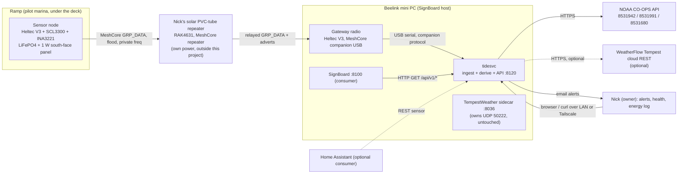
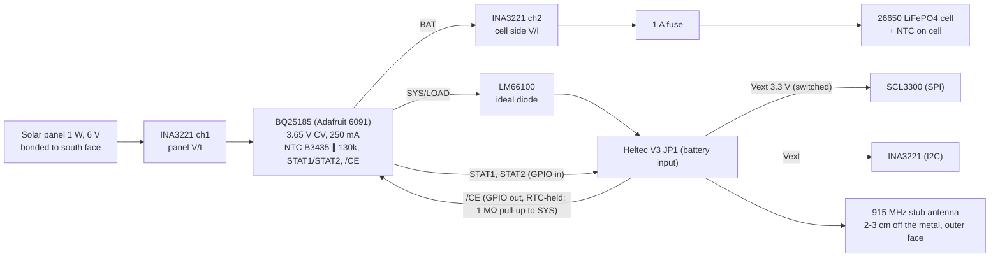
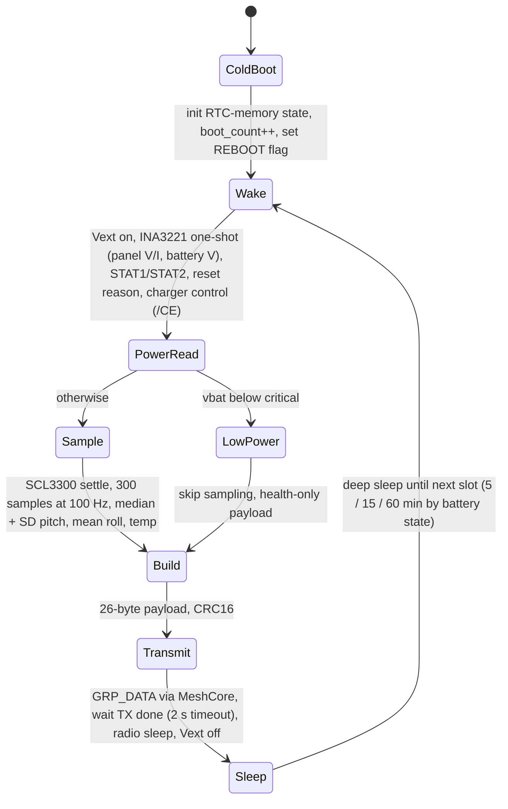
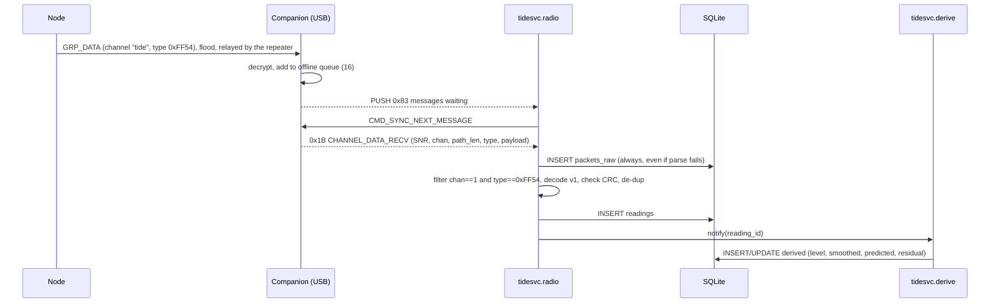
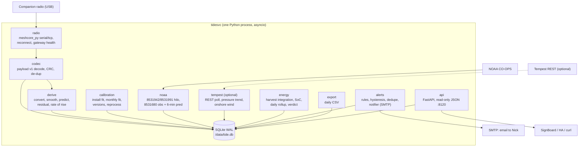
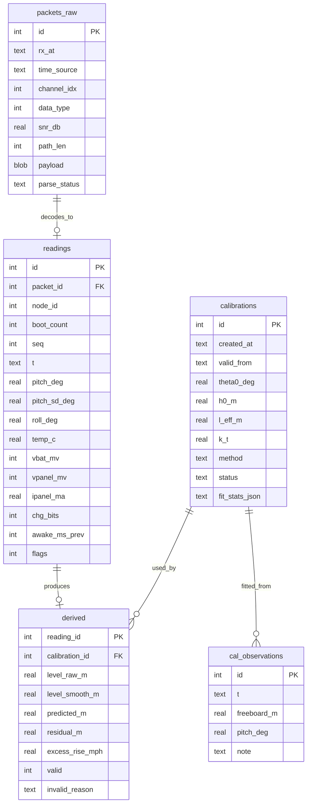

# Software Architecture: LoRa Ramp Tide Sensor

**Version:** 0.2 (draft)
**Last Updated:** 2026-10-10
**Author:** Nick DeMarco, with AI assistance (software-architecture agent)
**Status:** Draft, for Nick's review
**Inputs:** `docs/PRD.md` v0.3, `docs/BATTERY.md` v0.2 (source for the power subsystem), `workspace/research/SPEC.md` (build spec v0.1), `workspace/research/README-seed.md`

**Changes in v0.2 (2026-10-10), from Nick's decisions:**
- Power: charger is the **TI BQ25185 on Adafruit 6091** (CN3058E-class mention removed); 26650 LiFePO4; Heltec fed from charger SYS through an **LM66100** ideal diode; B3435 NTC with 130 kΩ in parallel (hardware about -3 °C stop / +2.4 °C resume), firmware owns the 0 °C rule. Sections 1.3, 4.2, ADR-006.
- **CE polarity fixed:** on the BQ25185, /CE HIGH disables charging. A pull-up keeps charging off unless the MCU enables it; firmware pulses /CE about every 4 h for the 6 h safety timer. Sections 4.2, 4.3, 4.7.
- **Repeater:** Nick's solar PVC-tube repeater (RAK4631) is the bridge between node and gateway. Flood routing replaces zero-hop (ADR-003); the private frequency and channel must match the repeater; link-margin criteria restated per hop for the private SF/BW; repeater health added to `tidesvc` (new section 5.5, `REPEATER_SILENT`). The repeater's own power budget is outside this project's solar test. Sections 1, 2.1, 3.1, 4.7, 5, 6.8, 6.9, 7, 10, ADR-003.
- **Energy alerts:** the 14-day `ENERGY_DEFICIT` verdict is the official answer; a 7-consecutive-negative-day `ENERGY_NEGATIVE_STREAK` early-warning email is added. Sections 6.6, 6.8.
- Tempest station 183092 with SignBoard's token, surge-watch defaults, Q7 and other answers folded in (sections 6.7, 6.9, 12 and the answers log).

Nick's decisions (2026-10-10) that this document treats as fixed:

| # | Decision |
|---|---|
| N1 | Transport is **MeshCore**. |
| N2 | Data lands on the **mini PC where SignBoard runs** (the Beelink), exposed as an **HTTP JSON API**. Home Assistant, SignBoard and others are consumers only. HA is **not** in the required path. |
| N3 | Hobby project. **Owner = Nick.** No commercial intent. Permission to mount is granted. |
| N4 | The pilot's key question is **whether the 0.5-1 W vertical south-face panel is large enough**, so battery and charge telemetry and an energy log are first-class. |
| N5 | PRD defaults accepted: LiFePO4 with a low-temperature charge cutoff; accuracy targets and alert defaults from the PRD. The tilt sensor choice is delegated to architecture (ADR-005: **SCL3300**). |
| N6 | (Added mid-session) The **WeatherFlow Tempest** station is an **optional** input to the ingest service, used for context: pressure, wind and rain. |

---

## 1. Executive Summary

### 1.1 System overview

A solar-powered Heltec WiFi LoRa 32 V3 under the ramp wakes every 5 minutes. It samples a Murata SCL3300 inclinometer for 3 seconds and reads battery and solar-charge telemetry. It then sends one small **encrypted MeshCore group datagram** (`PAYLOAD_TYPE_GRP_DATA`) on a private channel and returns to deep sleep. It never listens. This push-and-sleep design is the only way to fit MeshCore inside the energy budget of a small vertical panel; the stock MeshCore sensor firmware listens continuously (section 4.1).

Nick's solar PVC-tube **MeshCore repeater** (RAK4631) relays the frame (flood routing) to the gateway. A second Heltec V3 runs **stock MeshCore companion-radio firmware (USB)** and plugs into the mini PC. A single Python service, **`tidesvc`**, talks to that radio through the official `meshcore` Python library. It stores every frame raw in SQLite, converts tilt to water level, and computes the NOAA residual. It also keeps an energy log, polls the Tempest optionally, evaluates alerts, and serves a read-only JSON API. SignBoard, Home Assistant and anything else on the LAN read that API.

### 1.2 Key architectural decisions

| Decision | Choice | Rationale | ADR |
|---|---|---|---|
| Node firmware | Custom PlatformIO firmware using MeshCore **as a library**: wake, measure, send one group datagram, deep sleep | The stock `simple_sensor` keeps the radio listening and waits to be polled, which costs about 20-100x the energy budget. It also has no inclinometer driver. | 001 |
| Uplink message | Private-channel **group datagram**, data type `0xFF54` (dev range), 26-byte versioned payload | Binary, encrypted, no login or handshake. The companion firmware forwards it to the host as frame `0x1B`. | 001, 004 |
| Gateway | Stock **companion_radio_usb v1.17.1** on a 2nd Heltec V3, USB to the mini PC, `meshcore` (meshcore_py 2.3.15) | Released firmware with no custom code on the gateway. | 002 |
| Relay and radio | Nick's solar repeater bridges ramp and gateway; private frequency + encrypted channel; **flood** routing | Nick's decisions (Q1, Q2) | 003 |
| Tilt sensor | **SCL3300** | Purpose-built inclinometer with angle output, frame CRC and lower worst-case drift. | 005 |
| Power | 26650 LiFePO4 + **BQ25185** (Adafruit 6091) with NTC cold cutoff and firmware 0 °C rule + LM66100 feed + INA3221 energy telemetry | Answers N4 directly; details in BATTERY.md | 006 |
| Server | One Python 3.12 process (asyncio + FastAPI), SQLite (WAL), Docker Compose on the mini PC | One node and ~105k rows/year. Same deploy pattern as SignBoard. | 007, 008 |
| Errors | No demo data. Stale is an explicit error (HTTP 503 + `last_good`). | CLAUDE.md, PRD FR5 | 010 |
| Tempest | Optional REST poller with a personal token. Context and an advisory "surge watch" tier only. | UDP 50222 already has a designated listener on the mini PC. | 011 |

### 1.3 Technology stack

| Layer | Technology |
|---|---|
| Node MCU/radio | Heltec WiFi LoRa 32 V3 (ESP32-S3 + SX1262, 915 MHz) |
| Node firmware | PlatformIO, Arduino-ESP32, MeshCore pinned to tag `companion-v1.17.1` as a library (RadioLib, rweather/Crypto underneath) |
| Node sensors | Murata SCL3300 (SPI), TI INA3221 (I2C, 3-channel V/I), charger status GPIOs |
| Node power | LiFePO4 26650 (~3300 mAh rated), TI BQ25185 on Adafruit 6091 (3.65 V, 250 mA) with 10k B3435 NTC ∥ 130 kΩ, LM66100 ideal diode to Heltec JP1, 1 W 6 V flexible amorphous panel (BATTERY.md) |
| Repeater | Nick's solar PVC-tube repeater: RAK4631 + RAK19007, stock MeshCore repeater firmware on the private settings (its own Li-ion/bq24074 power is outside this project) |
| Gateway | Heltec V3 with MeshCore `Heltec_v3_companion_radio_usb` v1.17.1 (flashed from meshcore.io/flasher), USB serial (CP2102, `ttyUSB`) |
| Service | Python 3.12, `meshcore` 2.3.15, FastAPI + uvicorn, httpx, numpy, stdlib `sqlite3` |
| Storage | SQLite 3 (WAL) on a Docker volume, daily CSV exports |
| Deploy | Docker Compose on the Beelink mini PC (separate project from SignBoard), reached over the LAN and Tailscale |
| External data | NOAA CO-OPS datagetter (8531942, 8531991 predictions; 8531680 observed), WeatherFlow Tempest REST (optional) |

---

## 2. MeshCore today: research notes (verified 2026-10-10)

The MeshCore source (`meshcore-dev/MeshCore` at `a366955`, 2026-09-30), the companion protocol doc, `meshcore_py` (`meshcore-dev/meshcore_py`, 2.3.15, 2026-10-03), and PyPI were read directly. Items not verified are marked **[unverified]**.

### 2.1 Firmware roles

| Role | What it does | Released binary? | Relevance |
|---|---|---|---|
| **Companion radio** (USB / BLE / Wi-Fi variants) | Radio controlled by a host app over a framed binary protocol. Does not repeat. | Yes, `companion-v1.17.1` (2026-08-14) | **Our gateway** |
| **Repeater** | Relays flood and direct packets. Has an optional `powersaving` mode (light sleep, wakes on LoRa RX). | Yes, `repeater-v1.17.1` | **Nick's solar repeater is the bridge** (sections 5.4, 5.5) |
| **Room server** | BBS-style shared posts | Yes | No |
| **Sensor** (`examples/simple_sensor`, env `Heltec_v3_sensor`) | Advertises as a sensor. A logged-in client **requests** telemetry (`REQ_TYPE_GET_TELEMETRY_DATA`, CayenneLPP reply) or min/max/avg series. It pushes threshold alerts as text messages to admin contacts. Reads sensors every 60 s by default. | **No.** Build from source only. Reports `v1.17.1`. | Not used as-is (section 4.1) |
| KISS modem | Raw serial packet modem; the host does all protocol work | Build from source | Rejected: we would re-implement MeshCore crypto on the host |

### 2.2 How a node's telemetry reaches a host

- **Stock path (pull):** companion app/host → login request to the sensor → `GET_TELEMETRY_DATA` → CayenneLPP response → companion → host (`meshcore_py` event `TELEMETRY_RESPONSE`). The sensor must be **receiving at the moment of the request**, so it listens continuously.
- **Path we use (push):** sensor → `PAYLOAD_TYPE_GRP_DATA` on a channel → companion matches the channel hash/secret → host frame `RESP_CODE_CHANNEL_DATA_RECV` (`0x1B`). The frame carries SNR, channel index, path length, a 16-bit `data_type`, length and payload. `meshcore_py` 2.3.15 parses it into `EventType.CHANNEL_DATA_RECV` with `payload` as hex. This requires **companion firmware v1.15.0+** (stated in the meshcore_py parser).
- **Host interfaces on a companion:** USB serial (115200), BLE (Nordic UART service `6E400001-…`), and Wi-Fi TCP. `meshcore_py` offers `MeshCore.create_serial / create_tcp / create_ble`, `start_auto_message_fetching()`, `set_channel(idx, name, secret)`, and has an `auto_reconnect` flag. `meshcore-cli` 1.6.5 (fdlamotte) is handy for setup and debugging.
- **Buffering:** the companion queues inbound frames for the host. The **USB build uses the default `OFFLINE_QUEUE_SIZE` = 16** (BLE/Wi-Fi builds set 256). At one frame per 5 min that covers about 80 min of host downtime.
- **Timestamps:** group datagrams carry **no sender timestamp or identity** (protocol doc). The companion does not add a receive time either. The host stamps arrival time (section 6.3).

### 2.3 Size limits and the SPEC's 12-byte packet

| Limit | Value | Source |
|---|---|---|
| LoRa frame (`MAX_TRANS_UNIT`) | 255 B | `src/MeshCore.h` |
| Mesh payload (`MAX_PACKET_PAYLOAD`) | 184 B | `src/MeshCore.h` |
| Host frame (`MAX_FRAME_SIZE`) | 176 B | `BaseSerialInterface.h` |
| **Channel datagram payload (`MAX_CHANNEL_DATA_LENGTH`)** | **163 B** | companion `MyMesh.cpp`, protocol doc |
| Cipher | AES-128 in 16-byte blocks + 2-byte truncated HMAC | `MeshCore.h` (`CIPHER_BLOCK_SIZE` 16, `CIPHER_MAC_SIZE` 2) |

The SPEC's 12-byte packet fits easily. We still **adapt** it (ADR-004):

- It grows to 26 bytes to carry the energy telemetry N4 needs.
- Fields whose job MeshCore already does are dropped or reworked: the ack goes, and the timestamp is added server-side.
- It gains a version byte.

On air: 2 B data type + 1 B length + 26 B payload = 29 B plaintext → 32 B ciphertext. With 1 B header + 1 B path length + 1 B channel hash + 2 B MAC, the frame is **37 bytes**. That is ~181 ms on air on the USA preset (SF7/BW62.5/CR4:5). MeshCore uses a 16-symbol preamble (`CustomSX1262::std_init`).

### 2.4 Radio presets

Current community presets (api.meshcore.nz, fetched 2026-10-10) include **USA: 910.525 MHz / SF7 / BW62.5 / CR5**. The stock sensor example defaults to 915.0 MHz / SF10 / BW250 / CR5 at 20 dBm. **This project does not use the public preset** (Nick, Q2): node, repeater and gateway share one private frequency/SF/BW/CR, which must match exactly (ADR-003). The ~181 ms airtime in 2.3 is for SF7/BW62.5 and is recomputed for the chosen setting (DEV-PLAN E4.2).

### 2.5 What could not be verified

- The companion protocol doc carries the warning "still in development; may be inaccurate". The `0x1B` layout was cross-checked against the companion source and the meshcore_py parser, and they agree.
- **[unverified]** That a minimal sender (library `Mesh` subclass, no identity, no listening, deep sleep straight after TX) works unchanged on v1.17.1. This is spike **S1**.
- **[unverified]** Real RX/idle current of the stock sensor build on a Heltec V3. Our argument only needs it to be "≥ several mA", and that is certain for an awake ESP32-S3.
- `library.json` in MeshCore still says version 1.10.0. Pin by **git tag/commit**, not by library version.

---

## 3. System Context

### 3.1 Context diagram



### 3.2 External systems

| System | Purpose | Integration | Required? |
|---|---|---|---|
| NOAA CO-OPS datagetter | Predicted hi/lo for **8531942 Long Branch (inside)**, the prediction baseline. Predicted hi/lo for 8531991 (ocean phase reference). **Observed** level and 6-min predictions at **8531680 Sandy Hook** (weather-residual cross-check, calibration gating). | REST, JSON, no key (`application=lora_ramp_tide_sensor`) | Level works without it; **residual needs it** |
| WeatherFlow Tempest | Pressure, wind, rain context | REST + personal access token | **Optional** |
| SignBoard | Tide panel on kiosks | It polls our API | Consumer |
| Home Assistant | Whoever runs one | REST sensor | Consumer, optional |
| SMTP | Alert email to Nick | SMTP submission | Alerts only |

Verified 2026-10-10 against the live API:
- 8531942 returns `interval=hilo` only. `interval=6` returns "No Predictions data was found".
- **8531991 (Long Branch Fishing Pier) has no observed water level.** It is prediction-only too. **Sandy Hook 8531680 is the only nearby observed gauge.** This corrects SPEC §6, which treats 8531991 as an "ocean gauge" for weather residuals. It can still be used as an ocean-phase prediction reference.

### 3.3 Actors

| Actor | Interaction |
|---|---|
| Nick (owner/operator) | Install and calibration CLI, health and energy views, alert email, deploys |
| Residents / boaters | SignBoard tide panel (via SignBoard, not this service directly) |
| Consumers (SignBoard, HA, scripts) | Read-only JSON API on the LAN |

---

## 4. Node: Hardware and Firmware Design

### 4.1 Why custom firmware rather than stock MeshCore sensor firmware

| Option | Energy | Sensor support | Verdict |
|---|---|---|---|
| Stock `simple_sensor` (`Heltec_v3_sensor`) | ESP32-S3 awake with the SX1262 in RX continuously, at least several mA and realistically tens of mA. Even **10 mA is 240 mAh/day, ~20x our ~12 mAh/day push budget.** The sensor role has no power-saving loop (only the repeater has `powersaving`). | `EnvironmentSensorManager` supports I2C environmental and power sensors (BME280, SHT4x, INA219/226/260/**3221**, VL53L0X…). **No SCL3300 or ADXL355.** It reads every 60 s, not as a 3 s/100 Hz burst. | Rejected |
| Stock Heltec V3 firmware + I2C sensor | Same as above | Same as above | Rejected |
| **Custom firmware, MeshCore as a library, push + deep sleep** | ~10-12 mAh/day (section 4.4) | Our own SCL3300 and INA3221 drivers | **Chosen** (ADR-001) |

The node uses MeshCore only for what MeshCore is good at: correct framing, channel encryption, and listen-before-talk. It **never receives**: no adverts, no contacts, no identity load from SPIFFS (group datagrams need only the channel secret), and no repeating. Consequence: **no downlink.** Configuration changes need USB (section 4.7).

### 4.2 Hardware block diagram



Notes and bench items:

The power subsystem is specified in `docs/BATTERY.md` (wiring in its section 3.4); this section only summarises it.

- **Do not connect USB to the Heltec V3 while the LiFePO4 cell is attached, until bench test T6 (BATTERY.md) passes.** The board's onboard charger is a Li-ion (4.2 V) charger and would overcharge LiFePO4 (3.65 V max). The LM66100 ideal diode between charger SYS and Heltec JP1 should block it, but that is unverified. Label the enclosure. Use a battery disconnect or a jumper for programming. **[bench-verify]**
- The Heltec is fed from the BQ25185 **SYS/LOAD** output through the **LM66100** into **JP1** (1.25 mm battery connector), never into the 3V3 or 5V pins. SYS is panel-powered in sun and cut off below BUVLO 3.0 V. On battery, the onboard LDO may leave the 3.3 V rail near or slightly below the ESP32-S3's 3.0 V minimum during TX. Measure the brownout point on the bench (sweep 3.6 → 2.9 V, BATTERY.md T4). **[bench-verify]**
- **Cold charging (Nick, 2026-10-10).** The cell must not charge below 0 °C. Two layers:
  - Hardware backstop: the BQ25185 TS input with a **10k B3435 NTC bonded to the cell and 130 kΩ in parallel**, which moves the charger's window to about **-3 °C stop / +2.4 °C resume** (calculated, BATTERY.md 4.3-4.4; measure with T2).
  - Firmware owns the 0 °C rule: it **disables** charging below +1 °C and re-enables above +2 °C, using the SCL3300 die temperature as the in-box proxy for cell temperature.
- **/CE polarity (BQ25185):** /CE **HIGH disables charging**, LOW enables. A **1 MΩ pull-up from /CE to SYS** keeps charging **off unless the MCU actively drives /CE LOW**; the GPIO state is held through deep sleep (`gpio_hold_en`). If the MCU is dead, charging stays off; in sun SYS still powers the MCU so it can boot and re-enable (bench-verify, BATTERY.md T3). The firmware reports `cold_charge_inhibit` whether the inhibit comes from the charger (STAT fault) or from its own rule (CE override bit).
- **Charger status** comes from STAT1/STAT2 (open drain, pull-ups to 3V3): 1/0 charging; 1/1 done or disabled; 0/1 recoverable fault (TS cold or hot, OVP, thermal); 0/0 latch-off fault (safety timer, BATOCP). Firmware maps these to the `chg` byte (section 4.7), using its own temperature reading to tell a cold fault from the other 0/1 causes.
- **Vbat** is read by the INA3221 on the cell side (ch2). The Heltec's own battery ADC now sees SYS, not the cell.
- The SCL3300 and INA3221 sit on the switched Vext rail, so they draw nothing during sleep. The INA3221 is also put in power-down mode between reads.

### 4.3 Duty cycle



| Battery state (LiFePO4, under light load) | Interval | Payload |
|---|---|---|
| Normal (≥ 3.15 V) | 5 min | Full |
| Low (3.05-3.15 V) | 15 min, `reduced_interval` flag | Full |
| Critical (< 3.05 V) | 60 min | Health only (`sensor_skipped`) |

These thresholds are placeholders until the bench brownout measurement. LiFePO4's flat curve makes voltage a poor state-of-charge gauge above the knee. That is why the server also counts charge (section 6.6).

**Charger control (every wake, BQ25185 /CE: HIGH = charging disabled).**
- **0 °C rule:** if the temperature is below +1 °C, or unknown (sensor error), drive /CE HIGH (disable) and set the CE-override bit. Above +2 °C, drive /CE LOW (enable). Between +1 and +2 °C, keep the previous state (hysteresis). The pull-up makes "disabled" the default if the MCU is not driving the pin.
- **Safety-timer pulse:** the BQ25185 latches charging off after 6 h of fast charge, and termination may never happen while a weak panel holds it in VINDPM. Firmware counts continuous "charging" time (STAT 1/0) in RTC memory and, after about **4 h**, pulses /CE HIGH briefly (then LOW again) to restart the timer. Nightly loss of panel input also clears it. Bench test: BATTERY.md T7.
- Both are pure functions of (temperature, STAT, elapsed charging time) so they can be unit-tested natively.

**Cadence accuracy:** the Heltec V3 has no 32 kHz crystal populated **[unverified]**, so deep-sleep timing runs on the ESP32-S3's internal RC oscillator and can drift by about 1-5%. The server timestamps on arrival and the cadence is not used in any calculation. This architecture therefore relaxes **PRD FR1 "every 5 min ±10 s" to "5 min ±5%"** (accepted by Nick, Q8; PRD v0.3).

**Ack and retry:** SPEC §4 suggests an ack plus one retry. Group datagrams have no ack, and receiving one would mean listening. Instead, loss is measured with sequence numbers. A `tx_repeats` build option (default 0) can send the same frame twice about 1.5 s apart if the range test shows marginal delivery. The server de-duplicates on `(node_id, boot_count, seq)`.

### 4.4 Energy budget (load)

Estimated per-cycle profile. **Every number is an estimate until it is measured on the bench** (PPK2/Otii or a µCurrent).

| Phase | Duration | Current | Charge |
|---|---|---|---|
| Wake from deep sleep + init (no SPIFFS, no keys) | 0.30 s | 40 mA | 12 mAs |
| Vext on, INA3221 + charger pins | 0.10 s | 25 mA | 2.5 mAs |
| SCL3300 start-up/settle **[datasheet timing unverified]** | 0.25 s | 25 mA | 6 mAs |
| Sampling 300 @ 100 Hz | 3.0 s | 25 mA | 75 mAs |
| Radio init + listen-before-talk | 0.10 s | 30 mA | 3 mAs |
| TX 37 B at 22 dBm (~181 ms) | 0.18 s | 145 mA | 26 mAs |
| **Per cycle** | **~3.9 s** | | **~125 mAs ≈ 0.035 mAh** |

| Item | mAh/day |
|---|---|
| 288 cycles | 10.0 |
| Deep sleep, 30-100 µA (board + charger leakage + INA power-down) **[Heltec V3 real sleep current unverified; SPEC says ~20 µA, which is optimistic once a battery divider and charger are attached]** | 0.7-2.4 |
| **Nominal total** | **~11-12.5** |
| **Design budget (2x contingency)** | **25 mAh/day ≈ 80 mWh/day at 3.2 V** |

TX at 14 dBm instead of 22 dBm saves about 13 mAs per cycle. Pick the power from the range test (section 5.4).

**Battery autonomy** (80% usable, at the 25 mAh/day budget): a 26650 LiFePO4 (~3000 mAh) gives **~96 days**; an 18650 LiFePO4 (~1500 mAh) gives **~48 days**. Both easily exceed the PRD's 14-day no-sun target. **26650 chosen** (Q7 resolved: fits the Fibox PCB 65T by outside dimensions, to be physically verified; BATTERY.md 2.1 gives about 55 days with cold and aging derating).

### 4.5 Winter solar estimate: vertical south face, Monmouth Beach NJ

Source: **PVGIS v5.3** (EU JRC) monthly irradiation on a 90°, south-facing plane at 40.333 N, 73.981 W, ERA5 reanalysis, 2005-2023, DEM terrain horizon only. NREL PVWatts was unreachable from the research sandbox. Daily averages in kWh/m²/day, which equal peak-sun-hours (PSH):

| Month | Horizontal | **Vertical south (mean)** | Vertical south (worst year) |
|---|---|---|---|
| Nov | 2.31 | 3.94 | 2.89 |
| **Dec** | 1.75 | **3.45** | **2.75** |
| Jan | 2.12 | 3.88 | 2.98 |
| Feb | 2.98 | 4.14 | 2.92 |
| Jun (for contrast) | 6.31 | 2.33 | 2.11 |

A vertical south face collects **more** in winter than in summer at this latitude, which supports Nick's choice of mounting.

Harvest = panel W × PSH × η. Take η ≈ 0.5: a linear LiFePO4 charger delivers about Vbat/Vmp ≈ 0.6 of panel power, times ~0.85 for temperature, soiling, wiring and mismatch. Compared with the **80 mWh/day design budget**:

| Case | PSH | 0.5 W panel | 1 W panel |
|---|---|---|---|
| Dec mean | 3.45 | 0.86 Wh (10.8x) | 1.73 Wh (21.6x) |
| Dec worst year | 2.75 | 0.69 Wh (8.6x) | 1.38 Wh (17.2x) |
| Dec worst year, **50% local shading** (piles, boats, structure; unknown) | 1.38 | 0.34 Wh (4.3x) | 0.69 Wh (8.6x) |
| Single heavy-overcast day (vertical POA ≈ 0.4 kWh/m², **assumed**) | 0.4 | 0.10 Wh (1.25x) | 0.20 Wh (2.5x) |

**Conclusion.** On paper, panel size is not the binding constraint. 0.5 W is adequate and 1 W is comfortable, even with heavy shading. Three things can actually break winter operation, and the energy log is built to measure each one:

1. **Cold-charge inhibition.** A LiFePO4 cell under a shaded ramp will not charge on days when it stays below 0 °C. On those days harvest is zero regardless of panel size. Logged as `charge_inhibit_cold_h` per day.
2. **Local shading**, from the float, piles, boats in the adjacent slip, and the low December sun (~26° at noon). Logged as daily harvest against a clear-sky expectation.
3. **Real sleep current** of the Heltec V3 in this power path. Measured on the bench and checked in the field against battery drift on cold days.

PVGIS ERA5 caveats: it is reanalysis and can overstate irradiance under persistent cloud, and it includes no near-field obstructions. Treat the table as an upper-bound envelope, not a guarantee.

### 4.6 Measurement details

- **SCL3300**: SPI. Use the inclination-oriented low-noise mode with ~10 Hz on-chip filtering **[exact mode numbers and settling time from the datasheet are unverified]**. The 100 Hz reads are therefore correlated, giving about 30 effective samples per burst. That is still far inside the 0.01° target given ~0.001°/√Hz noise density.
- Per-cycle values: **median pitch**, **pitch SD**, **mean roll** (detects bracket creep or ramp twist), and **sensor temperature** (also stands in for battery temperature, since both are in the same box).
- Any frame with a bad SPI CRC or status → `sensor_error`, and the pitch fields are invalid.
- Coarse on-node out-of-range check: |pitch| > 15° or |roll| > 10° sets `out_of_range`. The fine envelope check runs on the server against the calibrated range, because the node cannot be reconfigured over the air.

### 4.7 Uplink payload v1 (ADR-004)

Little-endian. Carried as the channel-datagram payload with `data_type = 0xFF54`, from the MeshCore dev range `0xFF00-0xFFFE`, which needs no registration.

| Off | Field | Type | Unit / notes |
|---|---|---|---|
| 0 | `ver` | u8 | `1` |
| 1 | `node_id` | u8 | `1` for the pilot |
| 2 | `seq` | u16 | increments per frame; wraps in ~227 days at 5 min |
| 4 | `boot_count` | u8 | wraps; disambiguates seq after a reboot |
| 5 | `pitch_med` | i16 | 0.001° (±32.767°) |
| 7 | `pitch_sd` | u16 | 0.001°. Was u8 in the SPEC; widened so wake and storm SD does not saturate at 0.255°. |
| 9 | `roll_mean` | i16 | 0.01° |
| 11 | `temp` | i16 | 0.1 °C (SCL3300 die) |
| 13 | `vbat` | u16 | mV (INA3221 ch2 bus) |
| 15 | `vpanel` | u16 | mV (INA3221 ch1 bus) |
| 17 | `ipanel` | u16 | 0.1 mA, panel-side charger input current |
| 19 | `chg` | u8 | bit0 CHRG (STAT 1/0), bit1 DONE (STAT 1/1 while /CE is LOW), bit2 cold_charge_inhibit (STAT 0/1 with low temperature, or firmware cold rule), bit3 firmware CE override (/CE held HIGH by firmware), bit4 charger latch fault (STAT 0/0), bit5 safety-timer CE pulse issued this cycle |
| 20 | `awake_ms_prev` | u16 | awake time of the previous cycle (energy accounting) |
| 22 | `flags` | u16 | bit0 low_batt, 1 critical_batt, 2 high_sd, 3 out_of_range, 4 reboot, 5 brownout_reset, 6 wdt_reset, 7 sensor_error, 8 ina_error, 9 reduced_interval, 10 sensor_skipped, 11 short_sample |
| 24 | `crc16` | u16 | CRC-16/CCITT-FALSE over bytes 0-23 |

Total: **26 bytes**. The CRC is kept even though MeshCore authenticates frames. The 2-byte MAC lets about 1 in 65k corrupted frames through, and the CRC also catches codec mismatches between the C++ and Python implementations.

**Provisioning:** the 16-byte channel secret, node id, TX power, the private radio settings (frequency, SF, BW, CR; identical to the repeater and gateway) and the routing mode (**flood** by default; zero-hop kept for bench use) are written to NVS over USB serial with a one-time `provision` command. The secret is **not** compiled into the firmware or committed to git. The same secret is loaded into the gateway companion with `set_channel` (from `meshcore-cli` or by `tidesvc` at start-up).

### 4.8 Firmware repository layout

```
src/node-firmware/
  platformio.ini          # env heltec_v3_tide; MeshCore via git tag companion-v1.17.1
  src/main.cpp            # cycle state machine
  src/scl3300.{h,cpp}     # SPI driver, CRC checking, burst sampling
  src/power.{h,cpp}       # INA3221, charger pins, CE override, thresholds
  src/uplink.{h,cpp}      # payload codec, minimal MeshCore Mesh subclass, send + wait
  src/stats.{h,cpp}       # median, SD (testable natively)
  test/                   # PlatformIO native tests (codec, stats) using shared fixtures
```

---

## 5. Gateway: MeshCore Companion on the Mini PC

### 5.1 Attachment

- **Hardware:** a second Heltec V3 (~$20) with a 915 MHz antenna at a window or on a short coax run to an outside mount, **within range of the repeater** (it does not need to hear the ramp directly). It is powered over USB by the mini PC.
- **Firmware:** stock `Heltec_v3_companion_radio_usb` **v1.17.1**, flashed from meshcore.io/flasher. No custom gateway firmware.
- **Host link:** USB serial at 115200 (CP2102 → `/dev/ttyUSB*`). A udev rule creates a stable `/dev/meshcore-gw` symlink, matched on the board's serial number.
- **One-time configuration** (`meshcore-cli` or the `tidesvc gw-setup` CLI): the private radio parameters, identical on node, repeater and gateway, node name `tide-gw`, and **channel slot 1 = private channel "tide"** with the node's secret. The public channel can stay in slot 0. Its traffic is ignored by our filter.

### 5.2 Host-side ingest flow



- `meshcore_py` handles the companion protocol: `create_serial(port, 115200)`, `start_auto_message_fetching()`, subscribe to `EventType.CHANNEL_DATA_RECV`.
- **Gateway liveness** is checked separately from node liveness. Every 60 s the service runs a cheap companion command (device query / battery). If the serial link fails or the radio stops answering, gateway status becomes `error`, and the service reconnects with backoff (1 s → 60 s). Losing the link never crashes the API.
- **Distinguishing failures:** gateway `error` means the problem is at the mini PC. Gateway `ok` with no node frames is split by repeater health (section 5.5): repeater `ok` means the node is silent; repeater `silent` means check the repeater first. This distinction matters for the runbook.

### 5.3 Wi-Fi/TCP fallback

The repeater is the planned bridge (Q1 resolved), so the gateway only needs to reach the repeater. If the mini PC cannot reach the repeater either, put a **Wi-Fi companion** (`Heltec_v3_companion_radio_wifi`, built from source with Wi-Fi credentials **[build-from-source detail unverified on release binaries]**) at a better window and point `tidesvc` at it with `transport = "tcp"`. The `meshcore_py` code path is otherwise identical. BLE is not recommended on the Linux host (reliability, range).

### 5.4 Radio settings and range (ADR-003)

- **Private frequency and encrypted private channel** (Nick, Q2). No use of the public US preset. One frequency/SF/BW/CR inside 902-928 MHz, chosen from a local noise survey (DEV-PLAN E4.2), is set **identically on the node, the repeater and the gateway**; the channel secret is shared by node and gateway only (the repeater relays without decrypting). Starting point: SF7-SF9, BW62.5-125.
- **Routing: flood** (Nick, Q1: the repeater is the bridge). Zero-hop frames are not relayed, so zero-hop is kept only for bench tests. On a private frequency, flood reaches only radios on that frequency. The gateway may hear both a direct and a relayed copy; `tidesvc` de-duplicates on `(node_id, boot_count, seq)`. Node airtime and energy are unchanged by flood (the repeater spends the relay airtime).
- **Accept the link if**, over a 48 h test from the final node position (stub antenna, under the ramp) through the repeater in its final position: **end-to-end delivery ≥ 95%**, and **each hop** (node → repeater, repeater → gateway) has **≥ 10 dB margin over the demodulation floor of the chosen SF** (approximately −7.5 / −10 / −12.5 / −15 / −17.5 / −20 dB for SF7-SF12). So the median SNR must be at least +2.5 dB at SF7, 0 dB at SF8, −2.5 dB at SF9, −5 dB at SF10. The `0x1B` frame reports the SNR of the **last hop only** (repeater → gateway). The node → repeater hop is proved by the 10 dB attenuator test in the node antenna feed (TEST-PLAN RF-3), or by a temporary companion at the repeater's position.
- **If margin is short:** move all three radios to a higher SF, for example SF9-10 / BW125. Each SF step adds about 2.5 dB and roughly doubles airtime. At SF10/BW125 the 37-byte frame takes about 0.56 s (vs 0.18 s). At 22 dBm that adds about 4.4 mAh/day, taking the nominal load from ~12 to ~16 mAh/day, which is still inside the 25 mAh/day budget.
- **TX power:** start at 22 dBm for the range test, then reduce to the lowest setting that keeps ≥ 10 dB margin.
- **Consequence to confirm:** a repeater can only listen on one frequency. Moving Nick's repeater to the private setting means it **does not also serve the public US MeshCore mesh**.

### 5.5 Repeater health (so a dead repeater is distinguishable from a dead node)

The repeater is Nick's solar PVC-tube unit (RAK4631 + RAK19007, 2x 18650 Li-ion, bq24074). **Its own power budget is a separate concern, outside this project's solar test.** `tidesvc` only tracks whether it is alive, from what the gateway can hear:

| Evidence | How | Notes |
|---|---|---|
| Relayed node frames | Any `0x1B` frame with `path_len ≥ 1` | Proves the repeater relayed something within the last 5 min. Free. |
| Repeater adverts | The repeater is configured to send a periodic zero-hop advert (for example every 1-2 h). The companion surfaces adverts / contact updates to `meshcore_py`; `tidesvc` records the last advert time for the configured repeater public-key prefix. | **[unverified]** exact repeater setting names and the `meshcore_py` event for an advert. Checked in spike S1 or story E5.9. |
| Status request (optional) | `tidesvc` logs in to the repeater as guest and requests status every few hours (battery mV, uptime, packet counters). | **[unverified]** `meshcore_py` method names and fields. Off by default (`status_poll_s = 0`). The battery value is stored for context only; no energy verdict is computed for the repeater. |

- **Repeater status:** `ok` if any evidence is newer than `silent_after_s` (default 4 h, at least two advert intervals); otherwise `silent`; `unknown` until first heard.
- **Failure matrix:** gateway `error` → mini PC side. Gateway `ok`, repeater `ok`, node silent → node. Gateway `ok`, repeater `silent`, node silent → **check the repeater first**. Node frames arriving with `path_len = 0` while the repeater is silent → the gateway hears the node directly.
- Stored in `repeater_events` (section 6.9), exposed in `/api/v1/status` and `/api/v1/node/health`, alert `REPEATER_SILENT` (section 6.8).

---

## 6. Ingest Service (`tidesvc`)

### 6.1 Component diagram



### 6.2 Modules

| Module | Schedule / trigger | Responsibility |
|---|---|---|
| `radio` | Continuous | Companion connection, channel setup check, event subscription, gateway heartbeat (60 s), reconnect, repeater health (section 5.5) |
| `codec` | Per frame | Store raw; decode v1; CRC; de-dup on `(node_id, boot_count, seq)`; count sequence gaps |
| `derive` | Per reading, plus a 1-min tick for staleness | Pitch → level with the active calibration; trailing 30-min median; prediction interpolation; residual; rate of rise |
| `calibration` | CLI at install; monthly (1st, 03:00 local) | Fit, bound check, versioning, reprocess derived data |
| `noaa` | On start; daily 00:30; Sandy Hook every 6 min | Fetch and cache predictions and observations |
| `tempest` | Every 5 min if enabled | Poll, parse defensively, store, derive pressure trend and onshore wind |
| `energy` | Per reading; hourly; daily 00:05 | Integrate harvest, model consumption, state-of-charge estimate, daily rollup, verdict |
| `alerts` | Every 60 s | Evaluate rules, open/clear, de-duplicate, notify |
| `export` | Daily 00:15 | `/data/exports/YYYY-MM-DD.csv` (raw + derived) |
| `api` | Always | Read-only HTTP JSON |

There is a single writer connection behind an asyncio queue. The API reads through separate read-only connections, which WAL mode allows.

### 6.3 Time handling

- Everything is stored in **UTC**. The API returns ISO-8601 `Z` timestamps. Daily rollups and CSV filenames use **America/New_York** local days.
- `rx_at` = host receive time. **Backlog repair:** when the companion drains a queued backlog (several frames within a few seconds), timestamps are reconstructed. Each frame gets `t = t_newest − (seq_newest − seq) × interval_nominal`, and is marked `time_source = "backfilled"`. Backfilled readings are kept, but excluded from the live "current" view.

### 6.4 Conversion, smoothing, prediction, residual

**Conversion.** `level_m = h0 + L_eff · sin(radians(pitch_corr − θ0))`, where `pitch_corr = pitch_med − k_T·(temp − 25 °C)`. `k_T` comes from the bench temperature sweep and is 0 until measured.

**Validity.** A reading is excluded from level and alerts, but kept raw, if any of these hold: `sensor_error`; `out_of_range` (node flag or outside the calibrated envelope `[pitch_min − 0.5°, pitch_max + 0.5°]`); `pitch_sd > 0.25°`; or a backfilled time source when computing the live value.

**Smoothing.**
- **Live:** a *trailing* 30-min rolling median that needs ≥ 4 valid points, otherwise null with reason `insufficient_points`. It lags by about 15 min.
- **Historical analysis and calibration:** a *centred* 30-min median with no lag. This matters for the PRD's ±15 min hi/lo timing metric.
- The window is configurable (30/60 min).

**Prediction (8531942).** Hi/lo extremes over [−3 d, +7 d] are cached. Between consecutive extremes (t1,h1) and (t2,h2):
`pred(t) = h2 + (h1 − h2) · (1 + cos(π·(t − t1)/(t2 − t1))) / 2`.
A cached, published prediction that covers time t is valid, even if the last fetch failed. Predictions are deterministic, so that is not stale data. If **no published extreme pair brackets t**, the residual is an explicit error (`PREDICTION_UNAVAILABLE`). Predicted values are never shown in place of observations.

**Residual and rate of rise.**
- `residual = level_smooth − pred`.
- `excess_rise = slope(level_smooth, 60 min) − slope(pred, 60 min)`, in m/h, from a least-squares fit over the window.

**Reference cross-check.** Sandy Hook's `residual_SH = observed − 6-min predicted` is stored alongside ours. It is used (a) as context in the API and (b) to gate calibration fits to calm-weather days. It is not used to correct our level. SPEC's 2 h 18 m lag applies to the tidal phase, not necessarily to the weather residual. The comparison is shown, not modelled.

### 6.5 Calibration (ADR-009)

**Identifiability.** Over the ~6-7.5° swing, `sin` is nearly linear, so a shift in θ0 is almost indistinguishable from a shift in h0. **θ0 is therefore fixed** from the install level reading, and only **h0 (offset)** and **L_eff (scale)** are fitted.

| Step | Data | What it fixes |
|---|---|---|
| Install | ≥ 2 tape measurements, bulkhead mark → float reference, at tide states ≥ 0.5 m apart, entered with `tidesvc cal add-obs` | `L_eff` from Δlevel / Δsin(pitch), and h0 relative to the bulkhead mark |
| Datum tie (end of shakedown) | Calm-weather days (\|residual_SH\| < 0.10 m): observed extremes (centred smoothing, within ±90 min of each predicted extreme) vs NOAA predicted extremes | h0 in **MLLW**. The datum comes from NOAA predictions, **not a survey**. This is stated in the API (`datum` field). |
| Monthly refit | The same matched-extremes set over the last 30 days | (h0, L_eff) by least squares |

- **Bounds:** if |Δh0| ≤ 0.05 m and |ΔL_eff/L_eff| ≤ 3%, the fit is applied automatically as a new calibration version with `valid_from` = fit time. Otherwise it is stored as `proposed` and raises a `CALIBRATION_DRIFT` alert. Nick approves it with `tidesvc cal approve <id>`.
- **Versioning:** each derived row records its calibration version. `tidesvc reprocess --from …` recomputes derived data after an approved change. Raw data is never modified.
- **Known limitation:** fitting monthly to NOAA predictions forces the mean residual at the extremes toward zero over the month. Month-scale anomalies, such as seasonal mean sea level, are absorbed. Hours-to-days surge, the thing this project cares about, is preserved.

### 6.6 Energy log (N4)

| Quantity | How |
|---|---|
| Harvest (mAh from the panel) | Trapezoidal integral of `ipanel` over 5-min samples. The BQ25185 is linear with a power path: in sun, panel input current ≈ load current (via SYS) + cell charge current. So harvest is the panel's whole contribution, and harvest − consumption is the net change in the cell. Gaps > 15 min are not integrated, and daily `coverage_pct` is reported. |
| Harvest (mWh) | ∫ `ipanel · vbat` |
| Consumption (mAh) | Model: Σ `awake_ms_prev × I_awake` + sleep time × `I_sleep`. Both constants come from bench measurement and live in config, and each day records which constants were used. |
| State-of-charge estimate | Coulomb count of (harvest − consumption), **re-anchored to 100% at every DONE event** and clamped to [0, capacity]. Shown as `soc_est_pct` with its anchor time. |
| Charge-inhibited hours | Time with `cold_charge_inhibit` set |
| Reached full | Any DONE bit in the local day |
| Resting voltage | Minimum `vbat` between 02:00 and 05:00 local |

**Verdict** (rolling 14 days): `energy_ratio = Σharvest / Σconsumption`. **surplus** if ≥ 2; **marginal** if 1-2; **deficit** if < 1; `insufficient_data` if fewer than 7 days at ≥ 80% coverage. Also reported: days reaching full charge, and `projected_days_to_empty` when the 7-day net is negative. **The 14-day verdict is the official solar-sufficiency answer** (Nick, 2026-10-10).

**Early warning:** `negative_streak_days` = number of consecutive local days, up to yesterday, with `net_mah < 0`. Days below 80% coverage are skipped (they neither extend nor break the streak). At 7 it raises the `ENERGY_NEGATIVE_STREAK` early-warning email (section 6.8). It is a warning only and never changes the verdict.

Harvest records only what the charger **accepted**. On days that reach full it understates the energy available, but reaching full is itself the "panel is large enough" signal, so the verdict also counts full-charge days.

### 6.7 Tempest optional input (ADR-011)

- **Source:** WeatherFlow REST `GET https://swd.weatherflow.com/swd/rest/observations/station/{station_id}?token=…`, every 5 min. It uses a **personal access token** (tempestwx.com → Settings → Data Authorizations). WeatherFlow's docs describe personal tokens as intended for a single Tempest owner's personal use, which fits this project. Their remote-data-access policy text was not reviewed.
- **No UDP.** The Tempest hub broadcasts on UDP 50222 (WeatherFlow UDP reference v171). On the mini PC, however, the **TempestWeather sidecar is the designated sole listener on 50222** (SignBoard CLAUDE.md), and a bridge-mode container would not see LAN broadcasts anyway. The sidecar's `/api/data` returns display-formatted strings (for example `"--"`), not raw numbers, so it is not a good machine source. If raw-observation access from the sidecar is ever wanted, that is a separate TempestWeather change. This project does not modify it.
- **Fields used.** Verified in production use by SignBoard's `services/tempest.py`: `wind_avg`, `wind_gust`, `wind_direction`, `sea_level_pressure`, `pressure_trend`, `precip_accum_local_day`, `air_temperature`. **[unverified]**, from community usage: `timestamp`, `station_pressure`, `precip_accum_last_1hr`. The parser is defensive: any missing field becomes null with a field-level reason, never a default.
- **Derived context**, computed from our stored history and not from Tempest's string trend:
  - `pressure_change_3h_hpa`, which needs ≥ 2.5 h of history.
  - `inverse_barometer_m = (1013.25 − slp_hPa) × 0.01`, about 1 cm per hPa.
  - `onshore_wind_sustained`: 6-h vector-mean wind direction within the configured onshore sector (default **20°-140°**, NE through SE) **and** 6-h mean speed ≥ **8 m/s**. Defaults accepted by Nick (Q4), with the 3 hPa / 3 h pressure fall; tune after the first storm season.
- **Optional backfill** at start-up: `GET /observations/device/{device_id}?time_start&time_end` returns arrays in `obs_st` order (pressure at index 6, wind avg at 2, direction at 4, rain per minute at 12, per UDP reference v171). This fills the 3-h pressure history. **[REST device-endpoint layout unverified]**
- **Optional means optional.** With `tempest.enabled = false`, a missing token, or failing fetches, level, residual and all PRD alerts work unchanged. Tempest fields show `disabled`, `error` or `stale` (obs older than 15 min), always with null values. Tempest status never makes the overall level status degraded.
- **Station 183092**, the same station SignBoard uses, with SignBoard's existing token (Nick, Q3). The station is **near the dock**. Its exact position and wind exposure relative to the ramp are not stated, and they affect how meaningful the onshore-wind threshold is.

### 6.8 Alerts

Defaults come from the PRD. Each alert states its clear condition, alerts are de-duplicated by `kind` while open, and notification goes **by email only** to Nick (Q5; push deferred).

| Kind | Opens when | Clears when | Notify |
|---|---|---|---|
| `SURGE_WARNING` | residual ≥ +0.30 m on 2 consecutive evaluations | < +0.20 m for 30 min | Yes |
| `SURGE_SEVERE` | residual ≥ +0.60 m on 2 consecutive evaluations | < +0.50 m for 30 min | Yes |
| `RAPID_RISE` | excess_rise ≥ 0.15 m/h | < 0.08 m/h for 30 min | Yes |
| `SURGE_WATCH` (**Tempest context, advisory**) | residual ≥ +0.15 m **and** (Δp_3h ≤ −3 hPa **or** onshore_wind_sustained) | residual < +0.10 m, or both context conditions false for 1 h | Yes, marked advisory. **Only evaluated when Tempest is `ok`.** |
| `NODE_SILENT` | no valid reading for 30 min (displays go stale at 15) | next valid reading | Yes |
| `GATEWAY_DOWN` | companion link error > 5 min | link restored | Yes |
| `REPEATER_SILENT` | gateway `ok` and repeater status `silent` (no relayed frame, advert or status reply for `silent_after_s`, default 4 h) | any repeater evidence heard | Yes. The email says "check the repeater first" if the node is also silent. |
| `LOW_BATTERY` | vbat < 3.15 V on 3 consecutive readings, or `projected_days_to_empty` < 14 | vbat ≥ 3.25 V and projection ≥ 21 d | Yes |
| `ENERGY_DEFICIT` | 14-day verdict = deficit (**the official answer**) | verdict ≥ marginal | Yes (pilot) |
| `ENERGY_NEGATIVE_STREAK` (**early warning**) | `negative_streak_days` ≥ 7 (section 6.6) | first qualifying day with `net_mah` ≥ 0 | Yes, marked early warning |
| `SENSOR_QUALITY` | `pitch_sd` > 0.2° in ≥ 6 of the last 12, or `sensor_error` | < 2 of the last 12 | Yes |
| `OUT_OF_RANGE` | 3 consecutive out-of-range readings | 3 consecutive in-range | Yes |
| `PREDICTION_UNAVAILABLE` | no cached prediction covering now+24 h | covered again | Yes |
| `CALIBRATION_DRIFT` | monthly fit outside bounds | approved or rejected via CLI | Yes |
| `TEMPEST_UNAVAILABLE` | Tempest enabled but error/stale > 1 h | ok | **No** (status only; optional input) |

Every surge alert email includes the Tempest context when it is available (pressure change, wind, inverse-barometer estimate) and the Sandy Hook residual, or says explicitly "Tempest context unavailable".

### 6.9 Storage (SQLite)



Other tables:
- `noaa_predictions(station, t, v, type, fetched_at)`
- `noaa_observations(station, t, v, pred_v)`
- `tempest_obs(obs_at, fetched_at, slp_hpa, station_hpa, wind_avg, wind_gust, wind_dir, rain_1h_mm, rain_day_mm, air_c, raw_json)`
- `energy_daily(date, harvest_mah, harvest_mwh, consumption_est_mah, net_mah, coverage_pct, reached_full, charge_inhibit_cold_h, vbat_rest_v, temp_min_c, i_sleep_ua, i_awake_ma)`
- `alerts(id, kind, severity, opened_at, cleared_at, clear_condition, value, threshold, context_json, notified_at)`
- `gateway_events(t, event, detail)`
- `repeater_events(t, source, detail, snr_db, batt_mv)` (source = `relayed_frame` | `advert` | `status`; relayed frames update a last-seen value rather than adding a row each)
- `meta(schema_version)`

Volume is about 105k readings/year, which keeps the DB well under 100 MB/year. Retention is indefinite (PRD). A nightly `sqlite3 .backup` to `/data/backups/` keeps 14 copies, and is copied nightly to a second location (Nick, Q10; **location TBD**).

---

## 7. API (ADR-007, ADR-010)

- **Style:** REST, JSON, read-only, at `http://<mini-pc>:8120/api/v1/…`.
- **No authentication.** It is bound to the LAN and Tailscale and is **not** added to the Cloudflare tunnel. (PRD non-goal: no public API.)
- **All writes are CLI-only** inside the container: calibration observations, approvals, reprocessing.

### 7.1 Error and status conventions

- Every response has a top-level `status`: `ok` | `stale` | `error` | `disabled` | `insufficient_data`.
- Non-ok responses include `error: {code, message}`.
- **No demo data.** When a value cannot be computed, it is `null`. Predicted values never stand in for observed ones. The last good observation appears only inside an explicitly labelled `last_good` object with its own timestamp.
- **HTTP codes:**
  - `/level/current` returns **503** when the level is stale or unavailable, so HA REST sensors go `unavailable` and SignBoard can render "offline since …". The body carries the error and `last_good`.
  - Composite and history endpoints return 200, with per-component `status`.
  - `/healthz` returns 200 if the process is up.

### 7.2 Endpoints

| Method | Path | Purpose |
|---|---|---|
| GET | `/healthz` | Process liveness |
| GET | `/api/v1/status` | Component roll-up: gateway, repeater, node, noaa, tempest, calibration |
| GET | `/api/v1/level/current` | Current smoothed level, trend, predicted, residual |
| GET | `/api/v1/level/history?from&to&resolution=raw\|5m\|30m\|1h` | Level series with predicted alongside |
| GET | `/api/v1/residual?hours=48` | Residual series + Sandy Hook + Tempest context |
| GET | `/api/v1/predictions?from&to` | Interpolated 8531942 predictions and extremes |
| GET | `/api/v1/node/health` | Last packet, link stats, sensor, battery, repeater, gateway |
| GET | `/api/v1/node/energy?days=30` | Daily energy log + verdict |
| GET | `/api/v1/node/energy/samples?from&to` | 5-min panel/battery samples |
| GET | `/api/v1/weather/current` | Tempest context (optional) |
| GET | `/api/v1/alerts?state=open\|all&since` | Alerts |
| GET | `/api/v1/calibration` | Active and historical calibrations |
| GET | `/api/v1/export/{date}.csv` | Daily CSV |

### 7.3 Examples

`GET /api/v1/level/current`, healthy (200):
```json
{
  "status": "ok",
  "as_of": "2026-11-14T15:35:12Z",
  "age_s": 48,
  "level_m": 1.142,
  "level_raw_m": 1.158,
  "datum": "MLLW (tied to NOAA 8531942 predicted extremes; not surveyed)",
  "smoothing": {"method": "trailing_median", "window_min": 30, "n_points": 6},
  "trend": {"rate_m_per_h": 0.21, "direction": "rising", "excess_over_predicted_m_per_h": 0.03},
  "predicted_m": 1.020,
  "residual_m": 0.122,
  "residual_status": "ok",
  "calibration": {"version": 3, "valid_from": "2026-11-01T08:00:00Z"},
  "quality": {"pitch_sd_deg": 0.021, "flags": []},
  "weather_context": {"status": "ok", "pressure_change_3h_hpa": -1.2, "onshore_wind_sustained": false}
}
```

`GET /api/v1/level/current`, node silent (503):
```json
{
  "status": "stale",
  "error": {"code": "NODE_STALE", "message": "No valid reading for 47 min (stale after 15 min)."},
  "level_m": null,
  "residual_m": null,
  "predicted_m": 0.884,
  "last_good": {"at": "2026-11-14T14:48:03Z", "level_m": 1.031, "residual_m": 0.094},
  "components": {"gateway": "ok", "node": "stale", "noaa": "ok", "tempest": "disabled"}
}
```
`predicted_m` stays in this response because it is labelled as a prediction. Consumers must not render it as the water level.

`GET /api/v1/residual?hours=48` (200, truncated):
```json
{
  "status": "ok",
  "current": {"at": "2026-11-14T15:35:12Z", "residual_m": 0.122, "excess_rise_m_per_h": 0.03, "alert_level": "none"},
  "series": [
    {"t": "2026-11-14T15:30:00Z", "residual_m": 0.118, "valid": true},
    {"t": "2026-11-14T15:25:00Z", "residual_m": null, "valid": false, "reason": "missing_packet"}
  ],
  "prediction_source": {"station": "8531942", "method": "hilo_half_cosine", "fetched_at": "2026-11-14T05:30:02Z", "covers_until": "2026-11-21T04:12:00Z"},
  "reference": {"sandy_hook_8531680": {"status": "ok", "at": "2026-11-14T15:30:00Z", "residual_m": 0.15}},
  "weather_context": {
    "status": "ok",
    "pressure_change_3h_hpa": -3.4,
    "inverse_barometer_m": 0.07,
    "onshore_wind_sustained": true,
    "wind_6h_mean_mps": 9.1,
    "wind_6h_mean_dir_deg": 55
  }
}
```

`GET /api/v1/node/health` (200):
```json
{
  "status": "ok",
  "node_id": 1,
  "last_packet_at": "2026-11-14T15:35:12Z",
  "age_s": 48,
  "seq": 18234,
  "boot_count": 3,
  "link": {"snr_db": 7.25, "path_len": 1, "last_24h": {"received": 285, "expected": 288, "delivery_pct": 98.96, "duplicates": 0}},
  "sensor": {"pitch_deg": -1.234, "pitch_sd_deg": 0.021, "roll_deg": 0.41, "temp_c": 7.5, "flags": []},
  "battery": {"voltage_v": 3.318, "state": "normal", "charger": "charging", "cold_charge_inhibit": false, "soc_est_pct": 92},
  "repeater": {"status": "ok", "last_relayed_frame_at": "2026-11-14T15:35:12Z", "last_advert_at": "2026-11-14T14:02:40Z", "batt_mv": null},
  "gateway": {"status": "ok", "transport": "serial", "port": "/dev/meshcore-gw", "firmware": "companion v1.17.1", "connected_since": "2026-11-10T02:11:40Z"}
}
```

`GET /api/v1/node/energy?days=2` (200):
```json
{
  "status": "ok",
  "verdict": {
    "window_days": 14,
    "energy_ratio": 3.9,
    "assessment": "surplus",
    "days_reached_full": 11,
    "charge_inhibit_cold_h": 6.5,
    "projected_days_to_empty": null,
    "basis": "harvest = integrated panel current (charger-accepted); consumption = bench model, i_sleep 50 uA, i_awake profile 125 mAs/cycle"
  },
  "battery": {"capacity_mah": 3000, "soc_est_pct": 92, "soc_anchor": "DONE at 2026-11-13T18:20:00Z"},
  "daily": [
    {"date": "2026-11-13", "harvest_mah": 186.4, "harvest_mwh": 622, "consumption_est_mah": 11.8, "net_mah": 174.6,
     "coverage_pct": 99.0, "panel_peak_ma": 121.5, "vbat_rest_v": 3.31, "vbat_max_v": 3.58, "reached_full": true,
     "charge_inhibit_cold_h": 0.0, "temp_min_c": 4.5},
    {"date": "2026-11-12", "harvest_mah": 41.0, "harvest_mwh": 135, "consumption_est_mah": 11.9, "net_mah": 29.1,
     "coverage_pct": 97.2, "panel_peak_ma": 33.0, "vbat_rest_v": 3.29, "vbat_max_v": 3.36, "reached_full": false,
     "charge_inhibit_cold_h": 6.5, "temp_min_c": -1.5}
  ]
}
```

`GET /api/v1/weather/current`, with Tempest ok (200):
```json
{
  "status": "ok",
  "source": "tempest_rest",
  "station_id": 183092,
  "obs_at": "2026-11-14T15:34:00Z",
  "age_s": 72,
  "pressure": {"sea_level_hpa": 1006.2, "station_hpa": 1005.4, "change_3h_hpa": -3.4, "tempest_trend": "falling", "inverse_barometer_m": 0.07},
  "wind": {"avg_mps": 9.8, "gust_mps": 14.1, "dir_deg": 60, "onshore_now": true,
           "sustained_6h": {"mean_mps": 9.1, "mean_dir_deg": 55, "onshore_sustained": true, "sector_deg": [20, 140], "threshold_mps": 8.0}},
  "rain": {"last_1h_mm": 2.1, "today_mm": 18.4},
  "air_temp_c": 8.2
}
```
(`station_id` 183092 is SignBoard's station, confirmed for this project by Nick, Q3; SignBoard's token is reused.)

Tempest not configured (200; optional input):
```json
{"status": "disabled", "error": {"code": "TEMPEST_NOT_CONFIGURED", "message": "tempest.enabled is false"},
 "pressure": null, "wind": null, "rain": null, "air_temp_c": null}
```

Tempest failing (200):
```json
{"status": "error", "error": {"code": "TEMPEST_FETCH_FAILED", "message": "HTTP 401 from swd.weatherflow.com", "last_success_at": "2026-11-14T09:05:00Z"},
 "pressure": null, "wind": null, "rain": null, "air_temp_c": null}
```

`GET /api/v1/status` (200):
```json
{
  "status": "degraded",
  "components": {
    "gateway": {"status": "ok"},
    "repeater": {"status": "ok"},
    "node": {"status": "ok", "age_s": 48},
    "noaa": {"status": "error", "error": {"code": "NOAA_FETCH_FAILED", "message": "timeout"}, "predictions_cover_until": "2026-11-20T22:10:00Z"},
    "tempest": {"status": "disabled"},
    "calibration": {"status": "ok", "version": 3}
  }
}
```
Overall `degraded` means a required component is not ok, but cached predictions still cover the residual. Optional Tempest never moves the overall status. Repeater `silent` makes the overall status `degraded`.

### 7.4 Consumer notes

- **SignBoard:** poll `/api/v1/level/current` every 60 s from its backend at `host.docker.internal:8120`, the same pattern it uses for TempestWeather on :8036. The tide panel is a **separate SignBoard work item**; this project does not change the SignBoard repo. Today SignBoard's tide service uses `NOAA_STATION_ID=8531680` (Sandy Hook).
- **Home Assistant (optional):** a `rest` sensor on `/api/v1/level/current` with `value_template: "{{ value_json.level_m }}"`. A 503 makes it `unavailable`, which is correct.

---

## 8. Deployment on the Mini PC (ADR-008)

Existing deployment on the mini PC (read only, nothing modified):
- **SignBoard:** FastAPI in Docker on the **Beelink mini PC alongside VistterStream**, port **8100**, SQLite in a named volume. It is deployed by rsync + rebuild over Tailscale, with no CI, and is public via a Cloudflare tunnel.
- **TempestWeather:** a VistterStream sidecar using `network_mode: host`, serving HTTP on **8036**. It is the only UDP 50222 listener.

The plan follows the same pattern as a **separate compose project**:

```
/opt/tidesvc/                       (on the mini PC)
  docker-compose.yml
  .env                              # secrets: SMTP creds, TEMPEST_TOKEN; never committed
  config.toml                       # non-secret settings
/etc/udev/rules.d/99-meshcore-gw.rules
```

```yaml
# docker-compose.yml (sketch)
services:
  tidesvc:
    build: .
    container_name: tidesvc
    restart: unless-stopped
    ports: ["8120:8120"]            # confirm free on the mini PC (Q9)
    volumes:
      - tidesvc_data:/data
      - ./config.toml:/app/config.toml:ro
      - /dev:/dev                   # hot-plug: radio may re-enumerate
    device_cgroup_rules:
      - "c 188:* rmw"               # ttyUSB (CP2102 on Heltec V3)
      - "c 166:* rmw"               # ttyACM (other companion boards)
    env_file: .env
    environment:
      - TZ=America/New_York
    deploy:
      resources: {limits: {memory: 256M, cpus: "0.5"}}
volumes:
  tidesvc_data: {}
```

```
# /etc/udev/rules.d/99-meshcore-gw.rules
SUBSYSTEM=="tty", ATTRS{idVendor}=="10c4", ATTRS{idProduct}=="ea60", ATTRS{serial}=="<gw-serial>", SYMLINK+="meshcore-gw"
```

- The service starts and serves the API **even when the radio is absent**. Gateway status is `error`, and the radio task keeps retrying. That is why it mounts `/dev` plus cgroup rules instead of `devices:`; Docker refuses to create a container whose listed device is missing.
- **Fallback:** a systemd unit running a venv (`Restart=always`, user in `dialout`) is equally viable. Docker is chosen for consistency with how Nick already deploys on this box.

```toml
# config.toml (sketch)
[radio]
transport = "serial"            # serial | tcp
port = "/dev/meshcore-gw"       # or host = "<gateway LAN IP>", tcp_port = 5000
channel_idx = 1
data_type = 0xFF54
# channel secret comes from .env: TIDE_CHANNEL_SECRET

[repeater]
name = "<repeater name>"
pubkey_prefix = ""              # identifies Nick's repeater in adverts
silent_after_s = 14400          # >= 2 advert intervals
status_poll_s = 0               # 0 = passive only (relayed frames + adverts)

[node]
interval_s = 300
stale_after_s = 900
silent_alert_after_s = 1800

[calibration]
window_min = 30
envelope_margin_deg = 0.5
refit_bounds = {h0_m = 0.05, l_eff_rel = 0.03}

[noaa]
prediction_station = "8531942"
ocean_reference = "8531991"
observed_reference = "8531680"

[energy]
capacity_mah = 3000             # 26650 rated ~3300 (BATTERY.md); conservative planning value
i_sleep_ua = 50                 # replace with bench value
negative_streak_days = 7        # ENERGY_NEGATIVE_STREAK early warning
awake_mas_per_cycle = 125       # replace with bench value

[alerts]
surge_warning_m = 0.30
surge_severe_m = 0.60
excess_rise_m_per_h = 0.15
surge_watch_m = 0.15
email_to = ["<Nick's address, set in .env>"]

[tempest]
enabled = false                 # optional input
station_id = 183092             # Q3: SignBoard's station; token in .env TEMPEST_TOKEN (SignBoard's token)
poll_s = 300
stale_after_s = 900
onshore_sector_deg = [20, 140]
onshore_min_mps = 8.0
pressure_drop_3h_hpa = 3.0
```

**Deploy:** `deploy.sh` does rsync + `docker compose up -d --build` over Tailscale, matching SignBoard's flow. Nick runs it; there is no CI.

**Code layout (this repo):**
```
src/tidesvc/        radio.py codec.py derive.py calibration.py noaa.py tempest.py energy.py alerts.py export.py api.py db.py cli.py
src/node-firmware/  (section 4.8)
tests/              unit/ integration/ fixtures/ (shared packet vectors, NOAA, Tempest recordings)
deploy/             docker-compose.yml, Dockerfile, udev rule, deploy.sh, config.example.toml
docs/               PRD, ARCHITECTURE, runbook (later)
```

---

## 9. Security

The scope is small: a hobby project on the LAN.

- **RF:** frames are AES-128 encrypted with a 2-byte MAC, using a private channel secret. Anyone holding the secret can forge frames; that risk is accepted. Datagrams carry no sender signature (MeshCore protocol note). The node never receives, so there is no remote command surface on the node.
- **API:** read-only, LAN/Tailscale only, not on the Cloudflare tunnel.
- **Secrets:** the channel secret, SMTP credentials and Tempest token live in `.env` on the mini PC and in Apple Passwords, never in git (same rule as SignBoard).
- **Container:** non-root user in the `dialout` group, 256 MB memory limit.

---

## 10. Testing Approach

| Level | What | How |
|---|---|---|
| Codec | Payload v1 encode/decode, CRC, flags | **Shared golden vectors** (`tests/fixtures/packets_v1.json`) consumed by both PlatformIO native tests (C++) and pytest |
| Firmware logic | Median/SD, battery-state machine, interval selection | PlatformIO `native` env |
| Conversion and calibration | Fit recovers known (h0, L_eff) from synthetic tides + noise + freeboard jitter; bound logic; reprocessing | pytest with synthetic data |
| Prediction method | **Quantify half-cosine error:** interpolate Sandy Hook hi/lo and compare with its 6-min harmonic predictions over a year | pytest + recorded NOAA fixtures. The resulting error figure is documented. |
| Smoothing / rate | Trailing vs centred median, insufficient points, wake spikes | pytest |
| Energy | Integration with gaps, DONE re-anchoring, verdict thresholds | pytest |
| Alerts | Open/clear hysteresis, de-duplication, `SURGE_WATCH` only when Tempest is ok, clear-condition text | pytest with a frozen clock |
| **No demo data** | For every stale/error path: `level_m` is null, predicted is never in an observed field, `last_good` is labelled; 503 on stale | pytest API tests |
| Tempest | ok / disabled / 401 / timeout / missing fields / stale obs; **core endpoints identical with Tempest off** | respx-mocked HTTP with recorded responses |
| Ingest integration | A fake companion (pty speaking companion frames: `0x83`, `0x1B`) → DB → API; backlog drain and backfilled timestamps; unplug/replug | pytest + pty |
| NOAA | Fetch, cache, outage with cached coverage, outage past coverage | respx fixtures |
| Bench HIL | Tilt rig: noise ≤ 0.01° at fixed angles. Temperature sweep (freezer to +40 °C) gives `k_T`. Current profile with PPK2/Otii gives `i_sleep_ua` and `awake_mas_per_cycle`. Brownout sweep. Charger cold cutoff with the cell in a freezer. | Manual, results recorded in `docs/bench/` |
| Spike S1 | Minimal MeshCore GRP_DATA sender + deep sleep; companion v1.17.1 emits `0x1B` with the right bytes | First firmware task |
| RF | 48 h range test from the final node position through the repeater: ≥ 95% end-to-end delivery, ≥ 10 dB margin over the chosen SF's floor on each hop (section 5.4); repeat at high and low tide | Before anything is bonded (PRD) |
| Repeater health | Relayed frame / advert / silence → repeater `ok`/`silent`; `REPEATER_SILENT` distinct from `NODE_SILENT` and `GATEWAY_DOWN` | pytest with the fake companion |
| Acceptance | PRD §7 metrics; energy verdict through Dec-Feb | Shakedown + winter |

---

## 11. Architectural Decision Records (summary)

Each ADR can be split into `docs/architecture/decisions/` once accepted.

| ADR | Decision | Main rationale | Alternatives rejected |
|---|---|---|---|
| **001** Node transport and firmware | Custom PlatformIO firmware using MeshCore as a library; push a private-channel `GRP_DATA` frame, then deep sleep; never receive | Fits ~12 mAh/day; MeshCore framing and crypto without a listening radio | Stock `simple_sensor` (always-on RX, pull, no inclinometer); KISS modem (crypto on the host); raw RadioLib (Nick chose MeshCore) |
| **002** Gateway | Stock companion_radio_usb v1.17.1 on a Heltec V3, USB to the mini PC, `meshcore_py` 2.3.15 | Released firmware, official Python library, `0x1B` support | Custom gateway firmware; BLE companion; LoRaWAN |
| **003** Radio and routing (revised v0.2) | Private frequency + encrypted channel, settings identical on node, Nick's repeater and gateway (chosen in DEV-PLAN E4.2); **flood** routing through the repeater; accept at ≥ 95% end-to-end delivery and ≥ 10 dB margin over the chosen SF floor per hop | Nick's decisions (Q1 repeater bridge, Q2 private); zero-hop would not cross the repeater | Public USA preset (Nick chose private); zero-hop (not relayed); SF10/BW125 by default (~3x airtime, +4.4 mAh/day) unless the range test needs it |
| **004** Payload v1 | 26 B, versioned, CRC-16, data type 0xFF54 (dev range), energy fields, no ack | Covers N4; MeshCore limit is 163 B | SPEC's 12 B (no energy data); CayenneLPP (bigger, no seq/flags semantics); text messages |
| **005** Tilt sensor | **SCL3300** | Purpose-built inclinometer with on-chip angle output and selectable filters; SPI frame CRC (useful in a marine install); 1.2 mA active, 3 µA sleep; noise density ~0.001°/√Hz; typical offset drift < ±10 mg over −40…+125 °C (Murata). ADXL355's worst-case 0.15 mg/°C would be up to ~0.4° (~5.6 cm) over a 50 °C seasonal swing if uncompensated, though typical units are much better. Either part still needs a bench temperature characterisation; the driver interface keeps a swap open. | ADXL355 (excellent noise, needs our own angle maths, wider worst-case drift); MPU6050/LIS3DH (SPEC: avoid) |
| **006** Power and energy telemetry (revised v0.2) | 26650 LiFePO4; **TI BQ25185 on Adafruit 6091** (3.65 V, 250 mA); 10k B3435 NTC ∥ 130 kΩ as hardware backstop (about -3 °C / +2.4 °C); **firmware owns the 0 °C rule** via /CE (HIGH = disabled, pull-up so off by default) and pulses /CE about every 4 h for the safety timer; SYS → LM66100 → Heltec JP1; INA3221 panel/cell sensing; server-side coulomb count anchored at DONE. Source: BATTERY.md | Cold safety; answers "is the panel big enough" with measured harvest, cold-inhibit hours and full-charge days | 18650 Li-ion (cold charging); Heltec onboard charger (Li-ion 4.2 V); CN3058E-class (6.5 V abs max below the panel's ~7.7 V Voc; BATTERY.md 4.2); stock BQ25185 thresholds (+6 °C restart); INA228 accumulators (~0.6 mA would distort the budget being measured) |
| **007** Service and storage | One asyncio Python process (FastAPI) + SQLite WAL; read-only JSON API; HA/SignBoard as consumers | One node, small data, one owner | HA as hub (N2); Postgres/Influx (operational weight); MQTT broker (unneeded indirection) |
| **008** Deployment | Docker Compose project on the Beelink, :8120, udev symlink, `/dev` + cgroup rules for hot-plug | Matches the existing SignBoard/TempestWeather pattern; survives radio re-enumeration | systemd + venv (viable fallback); merging into SignBoard (coupling) |
| **009** Calibration | Fix θ0; fit h0 + L_eff; tape tie at install; datum from NOAA extremes; monthly bounded auto-refit gated by Sandy Hook calm days; versioned, reprocessable | θ0/h0 are collinear over a small swing; routine operation needs no expert | Free 3-parameter fit (ill-conditioned); survey tie (cost; could come later) |
| **010** Error semantics | No demo data; 503 + `last_good` on stale; cached published predictions valid until they run out; Tempest never degrades core status | CLAUDE.md, PRD FR5 | Serving predictions when the node is silent; HTTP 200 with zeros |
| **011** Tempest (optional) | REST poll with a personal token; derive pressure trend, inverse barometer and onshore wind; advisory `SURGE_WATCH` tier plus context in alerts | Adds early warning without becoming a dependency; respects the single UDP-listener rule | Own UDP listener (conflicts with TempestWeather; bridge networking); reading via SignBoard/sidecar (display strings, coupling); pushing node data into Tempest (not possible) |
| **012** Time-stamping | Host receive time; seq-based back-dating for queued backlogs, marked `backfilled` | Datagrams carry no timestamp; node has no clock | GPS/RTC on the node (energy, cost) |

---

## 12. Open Questions for Nick

All of Q1-Q11 are now answered (see the running log at the end of this document). The table is kept as the record of what was asked. Remaining open items are tracked in one place: `docs/DEV-PLAN.md` section 7.

| # | Question | Default if no answer |
|---|---|---|
| **Q1** | Where is the Beelink physically, and can a radio at its window see the ramp? | Range test from there. If margin < 10 dB, use the Wi-Fi companion at a better window, then a rooftop repeater. |
| Q2 | Is there MeshCore gear or a public MeshCore mesh nearby that you want this on, or should it run on a private frequency? | USA preset, zero-hop |
| **Q3** | Tempest: which station ID (SignBoard defaults to 183092), where is it relative to the ramp, and how exposed is it to wind? Reuse SignBoard's token or create a separate one? | Disabled until set; separate token |
| Q4 | Onshore sector and sustained-wind threshold for `SURGE_WATCH` | 20°-140°, ≥ 8 m/s for 6 h, Δp ≤ −3 hPa/3 h |
| Q5 | Alert channel and address (email only? ntfy push?) | Email to your address via SMTP |
| Q6 | Panel: 1 W or 0.5 W, and its voltage (5-6 V suits a linear LiFePO4 charger) | 1 W, 6 V |
| Q7 | Will the enclosure take a 26650 cell? | 26650 ~3000 mAh, else 18650 ~1500 mAh |
| Q8 | Accept relaxing FR1 timing to 5 min ±5% and dropping the SPEC's ack/retry? | Yes |
| Q9 | Is port 8120 free on the mini PC? (VistterStream's ports are unknown) | 8120 |
| Q10 | Off-box backup of `tide.db` (e.g. to your Mac over Tailscale)? | Local 14-day backups only |
| Q11 | When should the SignBoard tide panel (a SignBoard-repo change) be scheduled? | After the 2-week shakedown |

## 13. Unverified Items and Spikes (summary)

1. **S1:** minimal MeshCore library sender with deep sleep on v1.17.1 (section 2.5).
2. Heltec V3 real deep-sleep current in this power path; brownout voltage on LiFePO4; no-32 kHz-crystal timing drift.
3. BQ25185 cold thresholds with the 130 kΩ parallel resistor (calculated, BATTERY.md 4.3-4.4), the /CE fail-safe pull-up, the safety-timer pulse, and LM66100 USB blocking: bench tests T2, T3, T6, T7 in BATTERY.md.
4. SCL3300 per-mode noise, current and settling, taken from the actual datasheet. The figures above come from Murata/Mouser product pages.
5. Tempest REST fields `timestamp`, `station_pressure`, `precip_accum_last_1hr`, and the device-history endpoint's array layout.
6. PVGIS ERA5 winter irradiance as an upper bound; local shading unknown until a site check.
7. Wi-Fi companion build details (only needed for the fallback).
8. Repeater advert setting names, the `meshcore_py` advert event, and the optional repeater status request (section 5.5).

---

## 14. Revision History

| Version | Date | Author | Changes |
|---|---|---|---|
| 0.1 | 2026-10-10 | software-architecture agent | Initial draft: MeshCore push design, energy budget and winter solar estimate, tidesvc, API, deployment, testing, ADR list; Tempest optional input added at Nick's request |
| 0.2 | 2026-10-10 | software-architecture agent | Reconciled with Nick's decisions and BATTERY.md: BQ25185 power path and CE polarity fix, cold-charge layering, repeater as bridge (flood, private settings, per-hop margin, repeater health), 14-day verdict official plus 7-day early warning, Tempest/Q-answers folded in. See the Changes note at the top. |

## Nick's answers to §12 (running log)

- **Q1 Gateway location:** resolved 2026-10-10. A repeater will bridge the ramp to the gateway; placement is not a concern. It is **Nick's existing designed solar PVC-tube repeater** (RAK4631 + RAK19007). Applied in v0.2: flood routing (ADR-003), repeater health (5.5), repeater in the BOM.
- **Q2 Frequency/channel:** resolved 2026-10-10. Private frequency plus encrypted private channel; no use of the public US MeshCore preset. Frequency, bandwidth and spreading factor still to be chosen (inside 902-928 MHz, check local interference).
- **Q3 Tempest:** resolved 2026-10-10. Same station as SignBoard (183092); may share SignBoard's existing token. (Distance/wind exposure relative to the ramp not stated.)
- **Q4 Surge-watch thresholds:** accepted defaults 2026-10-10 (onshore wind 20-140 deg, >= 8 m/s for 6 h, pressure falling 3 hPa in 3 h); tune after the first storm season.
- **Q5 Alert channel:** resolved 2026-10-10. Email only for the prototype; push (ntfy) deferred.
- **Q6 Panel:** resolved 2026-10-10. Same type as the repeater's panel (1 W flexible amorphous, bought for the PVC-tube repeater); Nick will buy a second one for the node. Open-circuit voltage still to be measured; BATTERY.md: a 6 V panel at about 7.7 V Voc is fine for the BQ25185 (3.6-18 V operating). Note: flexible amorphous is lower efficiency than the Adafruit 3809 mono panel in the BOM, and cannot be stuck to a face without mounting care.
- **Q8 FR1 timing / ack:** resolved 2026-10-10. Relax FR1 to +/-5% and drop ack/retry (accepted). Report interval stays at 5 min for the pilot (node never listens, so changing it means reflashing).
- **Q9 Port:** accepted 2026-10-10: 8120, configurable.
- **Q10 Backup:** accepted 2026-10-10: nightly SQLite backup to a second location; location TBD by Nick.
- **Q11 SignBoard tide panel:** accepted 2026-10-10: built after the sensor is reporting, as a separate SignBoard change.
- **Q7 Enclosure vs 26650 cell:** resolved 2026-10-10. 26650 LiFePO4; fits the Fibox PCB 65T by outside dimensions (BATTERY.md 2.3), still to be physically verified.
- **Power subsystem (2026-10-10):** BQ25185 on Adafruit 6091 everywhere (BATTERY.md is the source); Heltec fed via LM66100 to JP1; no USB with the cell attached until bench-tested; 130 kΩ ∥ B3435 NTC with firmware 0 °C rule; /CE pull-up, CE pulse about every 4 h.
- **Energy alert (2026-10-10):** 14-day deficit verdict is the official answer; 7 consecutive negative days is an early-warning email.
